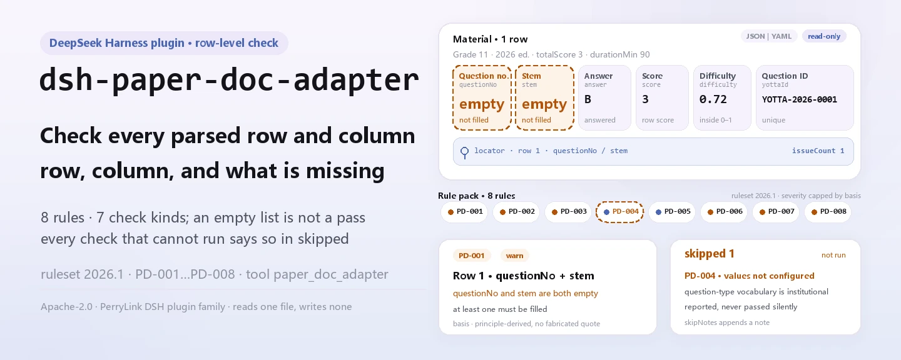
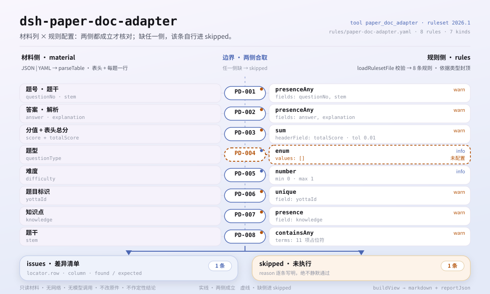

<div align="center">

<picture>
  <source media="(prefers-color-scheme: dark)" srcset="docs/assets/dsh-paper-doc-adapter-hero-en-dark.webp">
  
</picture>

# dsh-paper-doc-adapter

**Reports every mismatch in a parsed exam paper — which row, which field, what is off.**

A local check for exam and teaching administrators: hand it one parsed paper (header plus one row per question), eight rules test the result's structural self-consistency, and the output is a list you can point at; the material itself is never modified, and no verdict is pronounced.

[Install](#three-step-setup) · [Configuration](#configuration) · [FAQ](#faq) · [简体中文](README.md) · [English](README.en.md)

[](LICENSE)
[](#compatibility)
[](https://www.npmjs.com/package/dsh-paper-doc-adapter)
[](https://github.com/PerryLink/dsh-paper-doc-adapter/actions/workflows/ci.yml)
[](#compatibility)

[](https://github.com/PerryLink/dsh-paper-doc-adapter/stargazers)
[](https://www.npmjs.com/package/dsh-paper-doc-adapter)
[](https://dshfind.com/plugins/PerryLink/dsh-paper-doc-adapter?ref=badge)
[](https://securityscorecards.dev/viewer/?uri=github.com/PerryLink/dsh-paper-doc-adapter)
[](https://dsh.market/)
[](https://gitee.com/perrylink/dsh-paper-doc-adapter)

```sh
dsh plugin --profile <name> add dsh-paper-doc-adapter
```

</div>

<sub>Community plugin, not affiliated with DeepSeek. Canonical repository: <https://github.com/PerryLink/dsh-paper-doc-adapter> (Gitee is a mirror).</sub>

## What it is

`dsh-paper-doc-adapter` reads one parsed exam paper — the paper header plus one row per question — and checks that parse result's own structural self-consistency: that each question records its number and stem, that an answer or an explanation is present, that the question scores total the paper score the header states, that the question type comes from the vocabulary you configure, that the difficulty coefficient falls inside your range, that question identifiers are present and unique, that a knowledge point is recorded, and that no template placeholder survives in the stem. It lists only differences it can point at inside the material, never modifies the material, and pronounces no verdict; every check that could not run is reported in `skipped` with its reason instead of passing silently.

Who it is for: exam, question-setting and marking administrators — no command line required. What you give it: the source material the check works on (a table, register or document); Excel can be converted to JSON/YAML first, in chat if the platform supports it.

<picture>
  <source media="(prefers-color-scheme: dark)" srcset="docs/assets/dsh-paper-doc-adapter-flow-v5-dark.svg">
  
</picture>

## Three-step setup

1. **Install** (`0.2.10` is published on npm; this package is built before publishing and the npm package already contains `lib/`):

   ```sh
   # npm channel (published releases)
   dsh plugin --profile web add dsh-paper-doc-adapter
   # tarball channel: pnpm pack in this repo, then
   dsh plugin --profile web add ./dsh-paper-doc-adapter-0.2.10.tgz
   ```

2. **Minimal config** (the defaults work; swap the rule pack or stop a rule as needed):

   ```yaml
   - insert:
       - id: dsh-paper-doc-adapter
         name: dsh-paper-doc-adapter
         config:
           rulesFile: rules/paper-doc-adapter.yaml
           disabledRules: [PD-004]
   ```

3. **Verify it is live**:

   ```sh
   dsh --profile web --dump-config | grep 'dsh-paper-doc-adapter'
   ```

   You can also call the tool directly: `{"file": "/abs/path/paper.json"}` (or `{"material": "<JSON/YAML text>"}`) returns `issueCount`, `summary.error/warn/info`, `skippedCount` and a markdown report.

**Quickstart in the repo (one minute)**: `pnpm install && pnpm run build && node samples/quickstart/run.mjs` prints `paper_doc_adapter: 1 issue(s)` and `skipped: 1`. The sample lives in `samples/quickstart/input/`, the expected result in `samples/quickstart/expected/result.json`, and the capture in `docs/assets/quickstart.log` and `docs/assets/quickstart.png`.

**Uninstall**: `dsh plugin --profile web remove dsh-paper-doc-adapter` (or delete the row from the profile patch).

## Core capabilities

- **One material in, one difference list out** — feed it JSON or YAML (header plus one row per question); each difference carries `ruleId`, `severity`, `locator.row`, `locator.column`, `found` and `expected`, so the reader can go straight to the row and the column.
- **An empty list is not "nothing is wrong"** — every check that could not run goes to `skipped` with its reason (`skipNotes` appends your own note); nothing passes silently.
- **The rule pack is data, not code** — replace `rules/paper-doc-adapter.yaml` to swap the rule set without touching TypeScript; the pack is validated on load, not trusted.
- **Differences only, no verdict** — it does not rule on compliance, liability or correctness, and does not replace the reviewer; a wording guard keeps the disclaimer on every report.
- **The plugin is the tool** — it registers one tool, `paper_doc_adapter`, and registration is a Cordis effect: unloading or hot-reloading revokes it.

### Rule pack

| Rule | What it checks | Severity | Basis kind |
|---|---|---|---|
| `PD-001` | the question number and stem are recorded (at least one of the two) | warn | principle |
| `PD-002` | an answer or an explanation is present (at least one) | warn | principle |
| `PD-003` | the question scores total the paper score | warn | principle |
| `PD-004` | the question type comes from your vocabulary (off by default) | info | local |
| `PD-005` | the difficulty coefficient is inside your range | info | local |
| `PD-006` | question identifiers are present and unique | warn | principle |
| `PD-007` | a knowledge point is recorded | warn | principle |
| `PD-008` | the stem holds no unreplaced placeholder | warn | principle |

### Material format

The tool accepts JSON or YAML:

```yaml
paperTitle: 某某科目 2026 年模拟试卷
subject: 某某科目
grade: 高二
paperVersion: 2026 版
totalScore: '3'
durationMin: '90'
rows:
  - { 序号: '1', 题号: '1', 题型: 单选题, 题干: 下列关于……的说法，正确的是（　　）,
      选项: A. ……；B. ……；C. ……；D. ……, 答案: B,
      解析: 本题考查……，依据……，故 B 正确。, 分值: '3', 难度: '0.72',
      知识点: 某某章节 某某知识点, 题目ID: YOTTA-2026-0001, 标签: 基础题 }
```

Column names are matched case-insensitively and ignoring spaces, underscores and hyphens; the paper's own column names are kept, so a finding names the column it read. Note that the serial number column is read as the row's display number — give the question number its own column.

## What it answers

The examples come from this repo's test fixtures — real output, not an illustration. The rule pack does not fabricate citations, so every finding also names the clause it cites and states that the clause text was not obtained.

### Worked example

**Tool** `paper_doc_adapter`

**Input**

~~~json
{"paperTitle":"某某科目 2026 年模拟试卷","subject":"某某科目","grade":"高二","totalScore":"3","rows":[{"序号":"1","题号":"","题型":"单选题","题干":"","答案":"B","分值":"3"}]}
~~~

**Output**

~~~json
{
  "id": "dsh-paper-doc-adapter.PD-001.e8d6e3b5",
  "ruleId": "PD-001",
  "severity": "warn",
  "locator": {
    "column": "questionNo",
    "row": 1
  },
  "found": "第 1 行 questionNo、stem 都为空",
  "expected": "questionNo、stem 至少应填写一项",
  "basis": "《试题元数据规范》（JY/T 0606 系列（本次未取得条文）） 关于试题基本信息的条款（本次未取得条号）：「该条文本次未取得：核查未获得该文件的逐字原文，本规则库不伪造引文。」［原则性条款推论，非针对本项的明文要求］",
  "fix": "补填题号与题干；本条只核对是否填写，不判断题目质量"
}
~~~

*Observed from `tests/fixtures/PD-001/PD-001-unsafe.json` and `src/shared/rows.ts` (`presenceAny`)*

### Common questions

| You ask | What it answers |
|---|---|
| Both the question number and the stem are blank on a row — does the check say anything? | Yes. `PD-001` reports a row whose `questionNo` and `stem` are both empty, because it asks for at least one of the two. It checks that something is filled, not whether the question is well written or the stem rigorous. |
| A question has its number and stem, but neither an answer nor an explanation. | `PD-002` reports that row: it asks for at least one of `answer` and `explanation`. It does not check whether the answer is correct — that is subject-expert review, and the pack says as much. |
| The question scores add up to 98 while the header says 100 — is that caught? | Yes. `PD-003` adds the `score` column and compares the total with the `totalScore` the paper header states, allowing the configured tolerance of 0.01; if the header total is not a parseable number it reports itself in `skipped` instead. It only does the addition — whether the marks are distributed sensibly is not judged. |
| We never listed our own question types. What does the tool do with the question type column? | `PD-004` reports itself in `skipped`, because its `values` list ships empty: naming question types is your institution's convention and the engine hard-codes no list. Once you configure your values, a `questionType` outside them is reported; the rule then checks membership only, and it performs no question-type-specific structure check. |
| The difficulty column holds `1.2` in one row and a non-numeric label in another — what comes back? | `PD-005` reports the value it cannot parse as a number and the value outside the configured `min`/`max` range of 0–1. That range is your institution's convention, not the only scale — 1–5 or a percentage needs `min`/`max` changed or the rule disabled. It checks the range only, never whether the difficulty is appropriate, and it is capped at `info`. |
| Two questions carry the same yotta identifier. Why is that worse than a blank one? | `PD-006` reports the repeated value, comparing with whitespace ignored, because importing that parse result would silently overwrite an existing question; a blank identifier only keeps that one question out. With no identifier filled anywhere the rule reports itself in `skipped`. It checks presence and uniqueness, and nothing beyond that. |

## Standards it follows

| Document | Number | Cited by rules |
|---|---|---|
| Examination Question Metadata Specification | JY/T 0606 series (clause text not obtained this time) | PD-001, PD-002, PD-003, PD-006, PD-007, PD-008 |
| This institution's question-bank and item-setting conventions (institutional configuration) | No unified standard (the basis is this institution's question-type vocabulary) | PD-004 |
| This institution's question-bank and item-setting conventions (institutional configuration) | No unified standard (the basis is this institution's difficulty vocabulary) | PD-005 |

**Boundary:** this plugin checks a **parsed paper result** for structural self-consistency — that each question records its number and stem, that an answer or an explanation is present, that the question scores total the paper's score, that the question type comes from your vocabulary, that the difficulty coefficient falls inside your range, that question identifiers are present and unique, that a knowledge point is recorded, and that no placeholder survives. It does **not** decide whether a question is well written, whether an answer is correct, whether the difficulty is appropriate, or whether the paper meets its assessment objectives.

> ### ⚠️ What this plugin deliberately does not do
>
> **It treats the paper as a generic table and performs no question-type-specific checking.** So it **does not verify that an answer letter falls within the options offered**, that a fill-in-the-blank has the right number of blanks, or that a multiple-choice question has exactly one correct option. Those need the structure of each question type parsed, which this adapter does not attempt. That boundary is stated in the pack's header and in the troubleshooting section.
>
> **It never checks whether data is fit to import into a question bank beyond key presence and uniqueness.** A duplicate identifier is the dangerous case — importing would silently overwrite an existing question — which is why `PD-006` is `warn` and why it reports itself in `skipped` when no identifier column is present rather than checking the wrong column.
>
> **The difficulty range `0–1` is a local convention, not the only scale.** It is the common convention, larger meaning easier; a unit using 1–5 or a percentage can change `min`/`max` or disable the rule.
>
> **Every `excerpt` in the rule pack says, in so many words, that the clause text was not obtained** — the verification pass retrieved neither JY/T 0606's text nor the yotta platform's field specification. When the texts are in hand, replace each `excerpt` with the real clause and raise `kind` to `direct`.

**Rule sources:** the rule data lives in `rules/paper-doc-adapter.yaml` — its header explains what the plugin does not check, and each rule's `note` repeats the part that matters for that rule. The pack is versioned (currently `2026.1`) and the report carries it as `rulesetVersion`. The load-time guard still requires a document, clause, excerpt and source per rule, and still forbids a locally configured check from being `error`. `pnpm run check:citations` guards the citations separately: an obtainable quotation must be findable verbatim under `rules/evidence/`, and clauses not yet obtained are recorded in `rules/citations-baseline.json`, a ledger that may only shrink.

## Configuration

Every tunable lives in the Schemastery schema in `src/config.ts`, so `cordis.yml` alone changes behaviour without editing code; per-rule thresholds live in the rule pack under `rules/`. Overriding by id replaces the whole row — restate every key you need. `cordis.patch.yml` documents every key inline.

The keys used most:

| Key | Type | Default | Description |
|---|---|---|---|
| `rulesFile` | string | `rules/paper-doc-adapter.yaml` | Rule-pack path, relative to the package root |
| `disabledRules` | string[] | `[]` | Rule ids to stop running; each appears in `skipped` |
| `onlyRules` | string[] | `[]` | Run only these rule ids; empty runs every rule |
| `skipNotes` | string | `""` | Note appended to every `skipped` reason |
| `timeoutMs` | number | `120000` | Cooperative tool timeout budget |

<details>
<summary>Rule-level parameters (4 groups)</summary>

| Rule | Parameters | Description |
|---|---|---|
| `PD-003` | `field` / `headerField` / `tolerance` | The score column and the header total it must match, with a default tolerance of 0.01 |
| `PD-004` | `values` | Your question-type vocabulary; empty = no check (the rule enters `skipped`) |
| `PD-005` | `min` / `max` | The difficulty range, 0 to 1 by default |
| `PD-008` | `terms` | The placeholders to look for |

</details>

Profile patch override example:

```yaml
- insert:
    - id: dsh-paper-doc-adapter
      name: dsh-paper-doc-adapter
      config:
        disabledRules: [PD-005]
        skipNotes: see this institution's implementation rules
```

## FAQ

<details>
<summary>Is the material uploaded? Where does the data live?</summary>

No. This is a local-only checker: it reads the material you hand the tool (`file` or `material`) and makes no network requests, no uploads and no telemetry; it writes no data outside the tool result and the DSH host's own session/log storage. That storage is controlled by the host, and so is its retention; this package adds no second copy (see `PRIVACY.md`). Removing the package removes its code, but does not delete session logs the host already wrote or material you already created.

</details>

<details>
<summary>A fully compliant material returns an empty list — how should I read that?</summary>

An empty `issues` list only means "every check it could run passed"; it does **not** mean the material is fine. Every check that could not run is listed in `skipped` with its reason, for example `PD-004` with an empty question-type vocabulary, `PD-006` with no identifier column, or `PD-003` with a header total that is not a parseable number. Exported material often lacks columns, so those differences surface as `skipped` rather than crashing the program.

</details>

<details>
<summary>Does it fight other plugins over tool names, services or routes?</summary>

No. It registers one tool, `paper_doc_adapter`; it provides no service keys, registers no client slots (there is no browser half in this package), registers no `webServer` prefix and rewrites no globals; the bundle patch only inserts its own row. Registration is a Cordis effect, revoked on unload or hot reload. See "Interoperability with other DSH plugins" for the point-by-point argument.

</details>

<details>
<summary>How big is the performance overhead?</summary>

A local file read plus rule evaluation: no network requests, no model calls, no database writes. Each of the eight rules makes one pass over the material, and the timeout budget defaults to `120000` milliseconds (`timeoutMs`); for a whole directory prefer `ptc` mode, where the schema cost is paid once.

</details>

## Security boundaries

- **Read-only material.** The tool reads `file` or `material` and returns a report; it never writes back to the material and creates no second copy of it.
- **No network, no model calls.** All rule evaluation happens locally (see the scope note in `SECURITY.md`).
- **No verdict.** The report lists differences for a human to review; it does not pronounce on compliance, liability or correctness, and a wording guard keeps the disclaimer on every report.
- **No fabricated basis.** Every rule carries document, number, clause, excerpt, kind and source, and `excerpt` must be a verbatim quotation; where the verbatim text could not be obtained the excerpt says so and the severity stays capped at `warn` or `info` instead of posing as a quotation.
- **Fail closed.** An unimplemented check never passes silently: when it cannot run it enters `skipped` with its reason, and a check based only on institutional configuration may not be marked `error`.

## Known limitations

- **Treated as a generic table; no question-type-specific checking.** It does not verify that an answer letter falls within the options offered, that a fill-in-the-blank has the right number of blanks, or that a multiple-choice question has exactly one correct option — those need each question type's own structure parsed, which this adapter does not attempt.
- **Beyond key presence and uniqueness it does not check fitness for question-bank import.** A duplicate identifier is the dangerous case (importing would silently overwrite an existing question), which is why `PD-006` is `warn` and why it reports itself in `skipped` when no identifier column is present rather than checking the wrong column.
- **The difficulty range `0–1` is a local convention, not the only scale.** In the common convention a larger value means easier; a unit using 1–5 or a percentage changes `min`/`max` or disables the rule. `PD-005` is capped at `info`.
- **The question-type list ships empty.** With `PD-004`'s `values` empty the rule enters `skipped`; the engine hard-codes no question-type list and performs no question-type-specific structure check.
- **Every `excerpt` in the rule pack states that the clause text was not obtained this time.** The verification pass obtained neither JY/T 0606's verbatim text nor the yotta platform's field specification; once in hand, replace each `excerpt` with the real clause and raise `kind` to `direct`.

## Interoperability with other DSH plugins

- **No tool-name collision.** It registers only `paper_doc_adapter`, taking no bare name already held by a built-in tool or another plugin.
- **No service-key collision.** It provides no service keys, so there is no service-key contention.
- **No slot collision.** It registers no client slot key (this package is pure host, with no browser half).
- **No HTTP route collision.** It registers no `webServer` prefix.
- **No patch-layer collision.** `cordis.patch.yml` only `insert`s its own row and never overwrites a built-in row's `config`.
- **No global rewriting.** It changes no prototypes, rewrites no `process.env` and replaces no global fetch dispatcher.

## Compatibility

| Surface | Status |
|---|---|
| Harness | Peer range `>=0.1.2-rc.1 <0.2.0 \|\| >=0.2.0-0 <0.3.0`, measured to accept both `0.2.0-rc.2` and `0.2.1-rc.2`. `engines.dsh` is declared as `>=0.2.1-0 <0.3.0` and is enforced by the host since 0.2.1 |
| Node | `^22.19.0 \|\| >=24.0.0` |
| Platforms | All (plain ESM; no native code, no network, no model call) |
| Tool mode | Works in `native` and `ptc`; for a whole directory use `ptc` |

## Troubleshooting

- **It did not notice that an answer letter is outside the options.** By design: the plugin treats the paper as a generic table and performs no question-type-specific validation.
- **`PD-006` reports itself as skipped.** No identifier column is present, so the uniqueness check has nothing to key on. It reports that rather than checking the wrong column.
- **`PD-005` fires on a difficulty of `1.8`.** The default range is `0`–`1`; change `min`/`max` if your bank uses another scale.
- **`PD-003` fires although the paper adds up.** The header total and the sum of the rows disagree — usually a missing question or a mistyped score.
- **`PD-004` never runs.** Its vocabulary is empty; fill it with your bank's question types.
- **The plugin installs but the tool never appears.** Check that `main` resolves to `lib/index.mjs` and that `pnpm run build` produced it; a wrong `main` makes the loader skip the entry silently.
- **`dsh plugin add` refuses the package as incompatible.** The peer range covers `0.1.x` and `0.2.x`; if your runtime sits outside it, grant an explicit exemption: `dsh plugin --profile <name> allow-version dsh-paper-doc-adapter@0.1.0 --dsh-version <runtime> --accept-risk`.
- **`check` reports `manifest-peers` as failed.** The static checker compares against a hard-coded peer range that predates the 0.2 line. The runtime enforces peer compatibility at install time, so the declared range is the correct one; this is a known upstream issue in `dsh-plugin-dev`.
- **A rule did not run.** Look in the `skipped` array: it names the rule id and the reason.
- **A finding says the clause text was not obtained.** The citation gate reports that honestly: treat it as a verification gap, not as proof of compliance.
- **Time looks shifted.** Every calculation is wall-clock arithmetic on the input strings; no time-zone conversion is performed.
- **Everything is `warn` or `info`.** By design: this plugin makes no legal, medical, customs or safety determination; it lists differences and gaps for a human to decide on.

## Ecosystem & quality

- [Gitee mirror](https://gitee.com/perrylink/dsh-paper-doc-adapter) (synced mirror; GitHub is canonical)
- [dshfind plugin page](https://dshfind.com/plugins/PerryLink/dsh-paper-doc-adapter) (install counts and ranking)
- [OpenSSF Scorecard report](https://securityscorecards.dev/viewer/?uri=github.com/PerryLink/dsh-paper-doc-adapter) (driven by [.github/workflows/scorecard.yml](.github/workflows/scorecard.yml))
- [DSH Market](https://dsh.market/) (listed)
- **WorkBuddy / Coze channel**: search "Professional Document Check Suite" — this check is one part of it; availability as listed
- [Ecosystem field-test knowledge base](https://perrylink.github.io/dsh-plugin-guide/): plugin development guide · selection measurements · maintenance trade-offs

## Development

```sh
pnpm install
pnpm run typecheck   # tsc --noEmit
pnpm test            # vitest, the shared table-plugin suite plus paired fixtures
pnpm run build       # tsdown -> lib/index.mjs + lib/index.d.mts
pnpm run verify:self-contained
pnpm run check:lockfile
pnpm run check:readmes
pnpm run check:citations
pnpm pack            # the published tarball
```

The plugin is **data-only**: `src/model.ts` declares the table shape, the shared kit supplies the reader and the check engine, and the rule pack declares every check.

| Path | Role |
|---|---|
| `src/index.ts` | The function-plugin contract: registers `paper_doc_adapter` and resolves the rule-pack path |
| `src/config.ts` | The Schemastery schema, where every tunable lives |
| `src/model.ts` | The table shape and material contract: column aliases, `parseMaterial`, `runCheck` |
| `src/view.ts` | The model-facing projection of a report, mirroring `output.schema` |
| `src/shared/` | The shared kit (`table.ts` reader, `rows.ts` check engine, ruleset loader, report shape, YAML subset, calendar arithmetic, wording guard), copied in rather than imported |
| `rules/paper-doc-adapter.yaml` | The rule pack, eight rules |
| `rules/citations-baseline.json` | The citation ledger: records what is not traceable today and may only shrink |
| `tests/` | vitest; every rule has a paired compliant/violating fixture |

`ACCEPTANCE.csv` records one real run of `pnpm test`: 33/33 cases passing, 0 failing cases. The quickstart capture lives in `docs/assets/quickstart.log` and `docs/assets/quickstart.png`.

The figures are generated programmatically by [`scripts/gen-readme-assets.py`](scripts/gen-readme-assets.py) (Pillow + hand-written SVG): four hero WebP files (zh/en × light/dark) and two flow-v5 SVGs, built from `samples/quickstart/` and `rules/paper-doc-adapter.yaml`; re-run with `python scripts/gen-readme-assets.py`.

## Family & thanks

This project is part of the DeepSeek Harness plugin family from [PerryLink](https://github.com/PerryLink) (all Apache-2.0). If it is useful, **a star helps the next person find it** — nothing is gated behind it.

- [@PerryLink](https://github.com/PerryLink) — creator and maintainer: the rule pack `rules/paper-doc-adapter.yaml`, the `paper_doc_adapter` tool, the shared check-engine integration, and the five-language docs.

Full family index: [choose a checker by material](https://perrylink.github.io/zh/checkers/choose/) and [all plugins](https://github.com/PerryLink); this repository is one of them.

<details>
<summary>Expand all plugins</summary>

| Plugin | Status |
|---|---|
| **[dsh-aqua-input-check](https://github.com/PerryLink/dsh-aqua-input-check)** |  |
| **[dsh-archive-check](https://github.com/PerryLink/dsh-archive-check)** |  |
| **[dsh-auto-review](https://github.com/PerryLink/dsh-auto-review)** |  |
| **[dsh-autotier](https://github.com/PerryLink/dsh-autotier)** | 🧊 FROZEN — see the repo README |
| **[dsh-bid-ca-precheck](https://github.com/PerryLink/dsh-bid-ca-precheck)** |  |
| **[dsh-bid-qual-check](https://github.com/PerryLink/dsh-bid-qual-check)** |  |
| **[dsh-cert-mcp](https://github.com/PerryLink/dsh-cert-mcp)** | 🧊 FROZEN — see the repo README |
| **[dsh-checkpoint-rewind](https://github.com/PerryLink/dsh-checkpoint-rewind)** |  |
| **[dsh-click](https://github.com/PerryLink/dsh-click)** |  |
| **[dsh-composer-history](https://github.com/PerryLink/dsh-composer-history)** |  |
| **[dsh-contract-stance](https://github.com/PerryLink/dsh-contract-stance)** |  |
| **[dsh-customs-doc-check](https://github.com/PerryLink/dsh-customs-doc-check)** |  |
| **[dsh-data-quality](https://github.com/PerryLink/dsh-data-quality)** | 🧊 FROZEN — see the repo README |
| **[dsh-demurrage-ledger](https://github.com/PerryLink/dsh-demurrage-ledger)** |  |
| **[dsh-doublecheck](https://github.com/PerryLink/dsh-doublecheck)** |  |
| **[dsh-drill-script-check](https://github.com/PerryLink/dsh-drill-script-check)** |  |
| **[dsh-eia-guide-check](https://github.com/PerryLink/dsh-eia-guide-check)** |  |
| **[dsh-emergency-plan](https://github.com/PerryLink/dsh-emergency-plan)** |  |
| **[dsh-essay-rubric-check](https://github.com/PerryLink/dsh-essay-rubric-check)** |  |
| **[dsh-evidence-check](https://github.com/PerryLink/dsh-evidence-check)** |  |
| **[dsh-export-ctl-check](https://github.com/PerryLink/dsh-export-ctl-check)** |  |
| **[dsh-fast](https://github.com/PerryLink/dsh-fast)** |  |
| **[dsh-fmea-table-check](https://github.com/PerryLink/dsh-fmea-table-check)** |  |
| **[dsh-forecast-penalty](https://github.com/PerryLink/dsh-forecast-penalty)** |  |
| **[dsh-fund-research](https://github.com/PerryLink/dsh-fund-research)** |  |
| **[dsh-github](https://github.com/PerryLink/dsh-github)** |  |
| **[dsh-gongwen-flow-check](https://github.com/PerryLink/dsh-gongwen-flow-check)** |  |
| **[dsh-gongwen-word-check](https://github.com/PerryLink/dsh-gongwen-word-check)** |  |
| **[dsh-guard-plan-qc](https://github.com/PerryLink/dsh-guard-plan-qc)** |  |
| **[dsh-hazchem-check](https://github.com/PerryLink/dsh-hazchem-check)** |  |
| **[dsh-hazplan-check](https://github.com/PerryLink/dsh-hazplan-check)** |  |
| **[dsh-hidden-risk-map](https://github.com/PerryLink/dsh-hidden-risk-map)** |  |
| **[dsh-hs-classify](https://github.com/PerryLink/dsh-hs-classify)** |  |
| **[dsh-icd-rule-check](https://github.com/PerryLink/dsh-icd-rule-check)** |  |
| **[dsh-industry-research](https://github.com/PerryLink/dsh-industry-research)** |  |
| **[dsh-lawcite-adapter](https://github.com/PerryLink/dsh-lawcite-adapter)** |  |
| **[dsh-laya](https://github.com/PerryLink/dsh-laya)** |  |
| **[dsh-lc-doc-check](https://github.com/PerryLink/dsh-lc-doc-check)** |  |
| **[dsh-learning-gap-check](https://github.com/PerryLink/dsh-learning-gap-check)** |  |
| **[dsh-library](https://github.com/PerryLink/dsh-library)** |  |
| **[dsh-local-ai](https://github.com/PerryLink/dsh-local-ai)** |  |
| **[dsh-lsp-actions](https://github.com/PerryLink/dsh-lsp-actions)** |  |
| **[dsh-mask](https://github.com/PerryLink/dsh-mask)** |  |
| **[dsh-mcp-panel](https://github.com/PerryLink/dsh-mcp-panel)** |  |
| **[dsh-medrec-qc](https://github.com/PerryLink/dsh-medrec-qc)** |  |
| **[dsh-memento](https://github.com/PerryLink/dsh-memento)** | 🧊 FROZEN — see the repo README |
| **[dsh-nsfc-form-check](https://github.com/PerryLink/dsh-nsfc-form-check)** |  |
| **[dsh-nurse-record-check](https://github.com/PerryLink/dsh-nurse-record-check)** |  |
| **[dsh-observe](https://github.com/PerryLink/dsh-observe)** |  |
| **[dsh-origin-rvc-check](https://github.com/PerryLink/dsh-origin-rvc-check)** |  |
| **[dsh-ota-review-check](https://github.com/PerryLink/dsh-ota-review-check)** |  |
| **[dsh-output-styles](https://github.com/PerryLink/dsh-output-styles)** |  |
| **[dsh-paper-doc-adapter](https://github.com/PerryLink/dsh-paper-doc-adapter)** |  |
| **[dsh-permission-rules](https://github.com/PerryLink/dsh-permission-rules)** |  |
| **[dsh-permit-report-check](https://github.com/PerryLink/dsh-permit-report-check)** |  |
| **[dsh-pipeline-check](https://github.com/PerryLink/dsh-pipeline-check)** |  |
| **[dsh-pleading-draft](https://github.com/PerryLink/dsh-pleading-draft)** |  |
| **[dsh-plugin-doctor](https://github.com/PerryLink/dsh-plugin-doctor)** | 🚫 RETIRED (repo archived) |
| **[dsh-plugin-guide](https://github.com/PerryLink/dsh-plugin-guide)** |  |
| **[dsh-plugin-kit](https://github.com/PerryLink/dsh-plugin-kit)** | 🚫 RETIRED (repo archived) |
| **[dsh-plugin-upgrade](https://github.com/PerryLink/dsh-plugin-upgrade)** | 🚫 RETIRED (repo archived) |
| **[dsh-policy-brief-draft](https://github.com/PerryLink/dsh-policy-brief-draft)** |  |
| **[dsh-power-loss-split](https://github.com/PerryLink/dsh-power-loss-split)** |  |
| **[dsh-power-ticket-check](https://github.com/PerryLink/dsh-power-ticket-check)** |  |
| **[dsh-ppap-check](https://github.com/PerryLink/dsh-ppap-check)** |  |
| **[dsh-protest-deadline](https://github.com/PerryLink/dsh-protest-deadline)** |  |
| **[dsh-railway-window](https://github.com/PerryLink/dsh-railway-window)** |  |
| **[dsh-repair-order-qc](https://github.com/PerryLink/dsh-repair-order-qc)** |  |
| **[dsh-research-report](https://github.com/PerryLink/dsh-research-report)** |  |
| **[dsh-review-reply-check](https://github.com/PerryLink/dsh-review-reply-check)** |  |
| **[dsh-rulefile-check](https://github.com/PerryLink/dsh-rulefile-check)** |  |
| **[dsh-safety-brief-check](https://github.com/PerryLink/dsh-safety-brief-check)** |  |
| **[dsh-score](https://github.com/PerryLink/dsh-score)** | 🧊 FROZEN — see the repo README |
| **[dsh-session-sync](https://github.com/PerryLink/dsh-session-sync)** |  |
| **[dsh-site-log-check](https://github.com/PerryLink/dsh-site-log-check)** |  |
| **[dsh-skill-pack-security](https://github.com/PerryLink/dsh-skill-pack-security)** |  |
| **[dsh-soe-decision-check](https://github.com/PerryLink/dsh-soe-decision-check)** |  |
| **[dsh-soilwater-check](https://github.com/PerryLink/dsh-soilwater-check)** |  |
| **[dsh-sop-sync-check](https://github.com/PerryLink/dsh-sop-sync-check)** |  |
| **[dsh-spc-gbt-adapter](https://github.com/PerryLink/dsh-spc-gbt-adapter)** |  |
| **[dsh-talk](https://github.com/PerryLink/dsh-talk)** |  |
| **[dsh-tender-extract](https://github.com/PerryLink/dsh-tender-extract)** |  |
| **[dsh-tender-matrix](https://github.com/PerryLink/dsh-tender-matrix)** |  |
| **[dsh-test-drive](https://github.com/PerryLink/dsh-test-drive)** |  |
| **[dsh-ticktick](https://github.com/PerryLink/dsh-ticktick)** | 🚫 RETIRED (repo archived) |
| **[dsh-translate](https://github.com/PerryLink/dsh-translate)** |  |
| **[dsh-warranty-calc](https://github.com/PerryLink/dsh-warranty-calc)** |  |
| **[dsh-budget](https://github.com/PerryLink/dsh-budget)** | 🧊 FROZEN — see the repo README |
| **[dsh-claude-move](https://github.com/PerryLink/dsh-claude-move)** | 🧊 FROZEN — see the repo README |
| **[dsh-defend](https://github.com/PerryLink/dsh-defend)** | 🧊 FROZEN — see the repo README |
| **[dsh-draw](https://github.com/PerryLink/dsh-draw)** | 🧊 FROZEN — see the repo README |
| **[dsh-reach](https://github.com/PerryLink/dsh-reach)** | 🧊 FROZEN — see the repo README |
| **[dsh-background-agents](https://github.com/PerryLink/dsh-background-agents)** | 🚫 RETIRED (repo archived) |
| **[dsh-session-pin](https://github.com/PerryLink/dsh-session-pin)** | 🚫 RETIRED (repo archived) |
| **[dsh-team-rooms](https://github.com/PerryLink/dsh-team-rooms)** | 🚫 RETIRED (repo archived) |

</details>

## License

[LICENSE](LICENSE) (Apache License 2.0) © 2026 dsh-paper-doc-adapter contributors

<p align="center"><sub>Apache-2.0 · Community plugin, not affiliated with DeepSeek.</sub></p>
