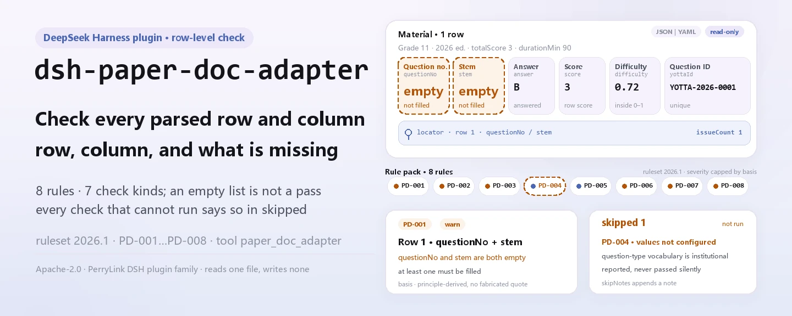
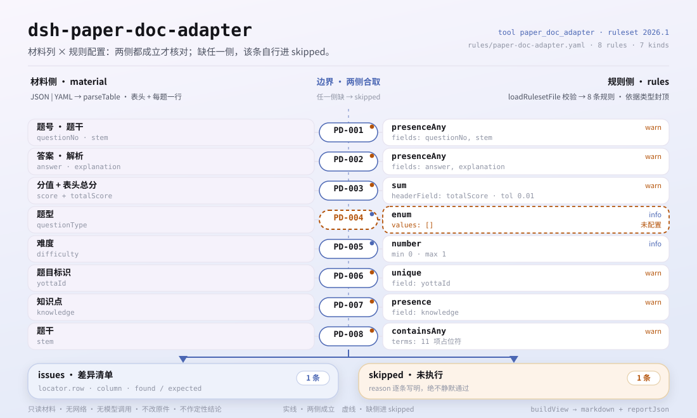

<div align="center">

<picture>
  <source media="(prefers-color-scheme: dark)" srcset="docs/assets/dsh-paper-doc-adapter-hero-en-dark.webp">
  
</picture>

# dsh-paper-doc-adapter

**Reporta cada desajuste de un examen ya parseado: qué fila, qué campo, qué falla.**

Una comprobación local para administración docente y de exámenes: le entregas un examen parseado (cabecera más una fila por pregunta), ocho reglas verifican la coherencia estructural del resultado y la salida es una lista señalable; el material nunca se modifica y no se emite ningún veredicto.

[Instalar](#instalación-en-tres-pasos) · [Configuración](#configuración) · [FAQ](#faq) · [简体中文](README.md) · [English](README.en.md) · [Español](README.es.md) · [Português](README.pt.md) · [हिन्दी](README.hi.md)

[](LICENSE)
[](#compatibilidad)
[](https://www.npmjs.com/package/dsh-paper-doc-adapter)
[](https://github.com/PerryLink/dsh-paper-doc-adapter/actions/workflows/ci.yml)
[](#compatibilidad)

[](https://github.com/PerryLink/dsh-paper-doc-adapter/stargazers)
[](https://www.npmjs.com/package/dsh-paper-doc-adapter)
[](https://dshfind.com/plugins/PerryLink/dsh-paper-doc-adapter?ref=badge)
[](https://securityscorecards.dev/viewer/?uri=github.com/PerryLink/dsh-paper-doc-adapter)
[](https://dsh.market/)
[](https://gitee.com/perrylink/dsh-paper-doc-adapter)

```sh
dsh plugin --profile <name> add dsh-paper-doc-adapter
```

</div>

<sub>Plugin de la comunidad, no afiliado a DeepSeek. Repositorio canónico: <https://github.com/PerryLink/dsh-paper-doc-adapter> (Gitee es un espejo).</sub>

## Qué es

`dsh-paper-doc-adapter` lee un examen parseado —la cabecera del examen más una fila por pregunta— y verifica la coherencia estructural de ese resultado de parseo: que cada pregunta registre su número y su enunciado, que exista una respuesta o una explicación, que la suma de puntajes de las preguntas iguale el total que declara la cabecera, que el tipo de pregunta provenga del vocabulario que configures, que el coeficiente de dificultad caiga dentro de tu rango, que los identificadores estén presentes y sean únicos, que haya un punto de conocimiento registrado y que no sobreviva ningún marcador de plantilla en el enunciado. Solo lista diferencias señalables dentro del material, nunca modifica el material y no emite veredicto alguno; toda comprobación que no pudo ejecutarse se informa en `skipped` con su motivo en lugar de pasar en silencio.

Para quién es: administración docente, de elaboración de exámenes y de calificación —sin necesidad de línea de comandos. Qué le entregas: el material de origen sobre el que trabaja la comprobación (una tabla, un registro o un documento); Excel puede convertirse antes a JSON/YAML, incluso en el chat si la plataforma lo permite.

<picture>
  <source media="(prefers-color-scheme: dark)" srcset="docs/assets/dsh-paper-doc-adapter-flow-v5-dark.svg">
  
</picture>

## Instalación en tres pasos

1. **Instalar** (`0.2.10` está publicada en npm; el paquete se compila antes de publicarse y el paquete npm ya incluye `lib/`):

   ```sh
   # canal npm (versiones publicadas)
   dsh plugin --profile web add dsh-paper-doc-adapter
   # canal tarball: pnpm pack en este repositorio y luego
   dsh plugin --profile web add ./dsh-paper-doc-adapter-0.2.10.tgz
   ```

2. **Configuración mínima** (los valores por defecto funcionan; cambia el paquete de reglas o detén una regla según necesidad):

   ```yaml
   - insert:
       - id: dsh-paper-doc-adapter
         name: dsh-paper-doc-adapter
         config:
           rulesFile: rules/paper-doc-adapter.yaml
           disabledRules: [PD-004]
   ```

3. **Verificar que está activo**:

   ```sh
   dsh --profile web --dump-config | grep 'dsh-paper-doc-adapter'
   ```

   También puedes llamar la herramienta directamente: `{"file": "/abs/path/paper.json"}` (o `{"material": "<texto JSON/YAML>"}`) devuelve `issueCount`, `summary.error/warn/info`, `skippedCount` y un informe en markdown.

**Prueba rápida en el repositorio (un minuto)**: `pnpm install && pnpm run build && node samples/quickstart/run.mjs` imprime `paper_doc_adapter: 1 issue(s)` y `skipped: 1`. El ejemplo está en `samples/quickstart/input/`, el resultado esperado en `samples/quickstart/expected/result.json` y la captura en `docs/assets/quickstart.log` y `docs/assets/quickstart.png`.

**Desinstalar**: `dsh plugin --profile web remove dsh-paper-doc-adapter` (o borra la fila del patch de perfil).

## Capacidades clave

- **Un material entra, una lista de diferencias sale** — recibe JSON o YAML (cabecera más una fila por pregunta); cada diferencia lleva `ruleId`, `severity`, `locator.row`, `locator.column`, `found` y `expected`, de modo que quien lee llega directo a la fila y a la columna.
- **Una lista vacía no significa "no hay nada mal"** — toda comprobación que no pudo ejecutarse va a `skipped` con su motivo (`skipNotes` añade una nota propia); nada pasa en silencio.
- **El paquete de reglas es dato, no código** — reemplaza `rules/paper-doc-adapter.yaml` para cambiar el conjunto de reglas sin tocar TypeScript; el paquete se valida al cargar, no se confía en él.
- **Solo diferencias, sin veredicto** — no dictamina cumplimiento, responsabilidad ni corrección, y no sustituye al revisor; un guardián de redacción mantiene el aviso en cada informe.
- **El plugin es la herramienta** — registra una sola herramienta, `paper_doc_adapter`, y el registro es un efecto de Cordis: descargar o recargar en caliente lo revoca.

### Paquete de reglas

| Regla | Qué comprueba | Severidad | Tipo de base |
|---|---|---|---|
| `PD-001` | el número y el enunciado están registrados (al menos uno de los dos) | warn | principle |
| `PD-002` | hay respuesta o explicación (al menos una) | warn | principle |
| `PD-003` | la suma de puntajes iguala el total del examen | warn | principle |
| `PD-004` | el tipo de pregunta proviene de tu vocabulario (desactivada de fábrica) | info | local |
| `PD-005` | el coeficiente de dificultad cae dentro de tu rango | info | local |
| `PD-006` | los identificadores están presentes y son únicos | warn | principle |
| `PD-007` | hay un punto de conocimiento registrado | warn | principle |
| `PD-008` | el enunciado no conserva marcadores sin reemplazar | warn | principle |

### Formato del material

La herramienta acepta JSON o YAML:

```yaml
paperTitle: 某某科目 2026 年模拟试卷
subject: 某某科目
grade: 高二
paperVersion: 2026 版
totalScore: '3'
durationMin: '90'
rows:
  - { 序号: '1', 题号: '1', 题型: 单选题, 题干: 下列关于……的说法，正确的是（　　）,
      选项: A. ……；B. ……；C. ……；D. ……, 答案: B,
      解析: 本题考查……，依据……，故 B 正确。, 分值: '3', 难度: '0.72',
      知识点: 某某章节 某某知识点, 题目ID: YOTTA-2026-0001, 标签: 基础题 }
```

Los nombres de columna se comparan sin distinguir mayúsculas y sin contar espacios, guiones bajos ni guiones; se conservan los nombres propios del material, así que cada hallazgo nombra la columna que leyó. Ojo: la columna de número de orden se lee como el número de presentación de la fila — dale al número de pregunta su propia columna.

## Qué responde

Los ejemplos provienen de los fixtures de prueba de este repositorio: salida real, no una ilustración. El paquete de reglas no fabrica citas, por eso cada hallazgo nombra también la cláusula que cita y deja constancia de que su texto no se obtuvo.

### Ejemplo detallado

**Herramienta** `paper_doc_adapter`

**Entrada**

~~~json
{"paperTitle":"某某科目 2026 年模拟试卷","subject":"某某科目","grade":"高二","totalScore":"3","rows":[{"序号":"1","题号":"","题型":"单选题","题干":"","答案":"B","分值":"3"}]}
~~~

**Salida**

~~~json
{
  "id": "dsh-paper-doc-adapter.PD-001.e8d6e3b5",
  "ruleId": "PD-001",
  "severity": "warn",
  "locator": {
    "column": "questionNo",
    "row": 1
  },
  "found": "第 1 行 questionNo、stem 都为空",
  "expected": "questionNo、stem 至少应填写一项",
  "basis": "《试题元数据规范》（JY/T 0606 系列（本次未取得条文）） 关于试题基本信息的条款（本次未取得条号）：「该条文本次未取得：核查未获得该文件的逐字原文，本规则库不伪造引文。」［原则性条款推论，非针对本项的明文要求］",
  "fix": "补填题号与题干；本条只核对是否填写，不判断题目质量"
}
~~~

*Observed from `tests/fixtures/PD-001/PD-001-unsafe.json` y `src/shared/rows.ts` (`presenceAny`)*

### Preguntas frecuentes

| Tú preguntas | Qué responde |
|---|---|
| El número y el enunciado están vacíos en una fila, ¿lo reporta? | Sí. `PD-001` reporta una fila cuyo `questionNo` y `stem` están ambos vacíos, porque pide al menos uno de los dos. Comprueba que algo esté lleno, no si la pregunta está bien redactada o el enunciado es riguroso. |
| Una pregunta tiene número y enunciado, pero ni respuesta ni explicación. | `PD-002` reporta esa fila: pide al menos uno de `answer` y `explanation`. No comprueba si la respuesta es correcta — eso es revisión de especialista de la materia, y el propio paquete lo dice. |
| Los puntajes suman 98 y la cabecera dice 100, ¿lo detecta? | Sí. `PD-003` suma la columna `score` y compara el total con el `totalScore` que declara la cabecera, con la tolerancia configurada de 0.01; si el total de la cabecera no es un número parseable, la regla se reporta en `skipped` en lugar de pasar. Solo hace la suma: no juzga si los puntajes están bien distribuidos. |
| Nunca configuramos nuestros tipos de pregunta. ¿Qué hace con la columna de tipo? | `PD-004` se reporta en `skipped`, porque su lista `values` viene vacía: nombrar los tipos de pregunta es convención de tu institución y el motor no codifica ninguna lista. Cuando configures tus valores, un `questionType` fuera de ellos se reporta; la regla entonces solo comprueba pertenencia y no hace ninguna validación estructural por tipo. |
| La columna de dificultad trae `1.2` en una fila y una etiqueta no numérica en otra, ¿qué devuelve? | `PD-005` reporta el valor que no puede parsear como número y el valor fuera del rango `min`/`max` configurado de 0–1. Ese rango es convención de tu institución, no la única escala: con 1–5 o porcentaje hay que cambiar `min`/`max` o desactivar la regla. Solo comprueba el rango, nunca si la dificultad es adecuada, y está limitada a `info`. |
| Dos preguntas llevan el mismo identificador yotta. ¿Por qué es peor que uno vacío? | `PD-006` reporta el valor repetido, comparando sin espacios, porque importar ese resultado sobrescribiría en silencio una pregunta existente; un identificador vacío solo deja esa pregunta fuera. Si no hay ningún identificador lleno, la regla se reporta en `skipped`. Comprueba presencia y unicidad, y nada más. |

## Normas que sigue

| Documento | Número | Reglas que lo citan |
|---|---|---|
| Especificación de metadatos de preguntas de examen | serie JY/T 0606 (texto de la cláusula no obtenido esta vez) | PD-001, PD-002, PD-003, PD-006, PD-007, PD-008 |
| Criterios de banco de preguntas y elaboración de esta institución (configuración institucional) | Sin estándar unificado (la base es el vocabulario de tipos de pregunta de esta institución) | PD-004 |
| Criterios de banco de preguntas y elaboración de esta institución (configuración institucional) | Sin estándar unificado (la base es el criterio de dificultad de esta institución) | PD-005 |

**Límite:** este plugin comprueba la **coherencia estructural de un resultado de parseo** — que cada pregunta registre número y enunciado, que haya respuesta o explicación, que la suma de puntajes iguale el total del examen, que el tipo provenga de tu vocabulario, que el coeficiente de dificultad caiga en tu rango, que los identificadores estén presentes y sean únicos, que haya un punto de conocimiento y que no sobreviva ningún marcador. **No** decide si una pregunta está bien redactada, si una respuesta es correcta, si la dificultad es adecuada ni si el examen cumple sus objetivos de evaluación.

> ### ⚠️ Lo que este plugin deliberadamente no hace
>
> **Trata el examen como una tabla genérica y no ejecuta ninguna comprobación específica por tipo de pregunta.** Por eso **no verifica que la letra de la respuesta esté entre las opciones ofrecidas**, ni que un relleno tenga el número correcto de huecos, ni que una pregunta de opción múltiple tenga exactamente una opción correcta. Eso exige parsear la estructura de cada tipo de pregunta, y este adaptador no lo intenta. Ese límite está escrito en la cabecera del paquete y en la sección de solución de problemas.
>
> **Nunca comprueba si los datos sirven para importarlos a un banco de preguntas más allá de la presencia y la unicidad de las claves.** Un identificador duplicado es el caso peligroso —importar sobrescribiría en silencio una pregunta existente— y por eso `PD-006` es `warn` y por eso se reporta en `skipped` cuando no hay columna de identificador, en lugar de comprobar la columna equivocada.
>
> **El rango de dificultad `0–1` es una convención local, no la única escala.** Es la convención común, con valores mayores más fáciles; una unidad que use 1–5 o porcentaje puede cambiar `min`/`max` o desactivar la regla.
>
> **Cada `excerpt` del paquete de reglas dice con todas las letras que el texto de la cláusula no se obtuvo** — la verificación no consiguió ni el texto de JY/T 0606 ni la especificación de campos de la plataforma yotta. Cuando tengas los textos, reemplaza cada `excerpt` por la cláusula real y sube `kind` a `direct`.

**Origen de las reglas:** los datos viven en `rules/paper-doc-adapter.yaml` — su cabecera explica qué no comprueba el plugin y la `note` de cada regla repite la parte que importa para esa regla. El paquete está versionado (actualmente `2026.1`) y el informe lo refleja como `rulesetVersion`. El guardián de carga sigue exigiendo documento, cláusula, extracto y fuente por regla, y sigue prohibiendo que una comprobación de configuración institucional sea `error`. `pnpm run check:citations` vigila las citas aparte: una cita obtenible debe poder encontrarse literalmente en `rules/evidence/`, y las cláusulas aún no obtenidas se registran en `rules/citations-baseline.json`, un libro que solo puede encogerse.

## Configuración

Todo lo ajustable vive en el esquema Schemastery de `src/config.ts`, así que basta cambiar `cordis.yml` sin tocar código; los umbrales por regla están en el paquete de reglas bajo `rules/`. Sobrescribir por id reemplaza la fila completa: repite todas las claves que necesites. `cordis.patch.yml` documenta cada clave en línea.

Las claves más usadas:

| Clave | Tipo | Valor por defecto | Descripción |
|---|---|---|---|
| `rulesFile` | string | `rules/paper-doc-adapter.yaml` | Ruta del paquete de reglas, relativa a la raíz del paquete |
| `disabledRules` | string[] | `[]` | Ids de regla a detener; cada una aparece en `skipped` |
| `onlyRules` | string[] | `[]` | Ejecutar solo estos ids; vacío ejecuta todas |
| `skipNotes` | string | `""` | Nota añadida a cada motivo de `skipped` |
| `timeoutMs` | number | `120000` | Presupuesto de tiempo de espera cooperativo |

<details>
<summary>Parámetros por regla (4 grupos)</summary>

| Regla | Parámetros | Descripción |
|---|---|---|
| `PD-003` | `field` / `headerField` / `tolerance` | La columna de puntaje y el total de cabecera con el que debe coincidir; tolerancia por defecto 0.01 |
| `PD-004` | `values` | Tu vocabulario de tipos de pregunta; vacío = sin comprobación (la regla entra en `skipped`) |
| `PD-005` | `min` / `max` | El rango de dificultad, de 0 a 1 por defecto |
| `PD-008` | `terms` | Los marcadores que se buscan |

</details>

Ejemplo de sobrescritura del patch de perfil:

```yaml
- insert:
    - id: dsh-paper-doc-adapter
      name: dsh-paper-doc-adapter
      config:
        disabledRules: [PD-005]
        skipNotes: ver las reglas internas de esta institución
```

## FAQ

<details>
<summary>¿Se sube el material? ¿Dónde viven los datos?</summary>

No. Es un comprobador puramente local: lee el material que le entregas a la herramienta (`file` o `material`) y no hace peticiones de red, no sube nada y no envía telemetría; no escribe datos fuera del resultado de la herramienta y del almacenamiento de sesión/registros del propio host DSH. Ese almacenamiento lo controla el host, y también su retención; este paquete no añade una segunda copia (ver `PRIVACY.md`). Quitar el paquete elimina su código, pero no borra los registros de sesión que el host ya escribió ni el material que ya creaste.

</details>

<details>
<summary>Un material totalmente conforme devuelve una lista vacía: ¿cómo se lee?</summary>

Una lista `issues` vacía solo significa «pasaron todas las comprobaciones que podía ejecutar»; **no** significa que el material esté bien. Toda comprobación que no pudo ejecutarse aparece en `skipped` con su motivo, por ejemplo `PD-004` con vocabulario vacío, `PD-006` sin columna de identificador o `PD-003` con un total de cabecera que no es un número parseable. El material exportado suele tener columnas faltantes, así que esas diferencias aparecen como `skipped` en lugar de romper el programa.

</details>

<details>
<summary>¿Compite con otros plugins por nombres de herramienta, servicios o rutas?</summary>

No. Registra una sola herramienta, `paper_doc_adapter`; no aporta claves de servicio, no registra slots de cliente (este paquete no tiene mitad de navegador), no registra prefijos `webServer` y no reescribe globales; el patch del bundle solo inserta su propia fila. El registro es un efecto de Cordis, revocado al descargar o recargar. El argumento punto por punto está en «Interoperabilidad con otros plugins DSH».

</details>

<details>
<summary>¿Cuánto cuesta en rendimiento?</summary>

Una lectura local de archivo más la evaluación de reglas: sin peticiones de red, sin llamadas al modelo, sin base de datos. Cada una de las ocho reglas hace una pasada sobre el material, y el presupuesto de tiempo de espera es de `120000` milisegundos por defecto (`timeoutMs`); para un directorio completo conviene el modo `ptc`, donde el coste del esquema se paga una sola vez.

</details>

## Límites de seguridad

- **Material de solo lectura.** La herramienta lee `file` o `material` y devuelve un informe; nunca reescribe el material ni crea una segunda copia.
- **Sin red y sin llamadas al modelo.** Toda la evaluación de reglas ocurre localmente (ver la nota de alcance en `SECURITY.md`).
- **Sin veredicto.** El informe lista diferencias para revisión humana; no dictamina cumplimiento, responsabilidad ni corrección, y un guardián de redacción mantiene el aviso en cada informe.
- **Base no fabricada.** Cada regla lleva documento, número, cláusula, extracto, tipo y fuente, y el `excerpt` debe ser una cita literal; cuando el texto literal no se pudo obtener, el extracto lo dice y la severidad queda limitada a `warn` o `info` en lugar de hacerse pasar por cita.
- **Falla cerrado.** Una comprobación no implementada nunca pasa en silencio: cuando no puede ejecutarse entra en `skipped` con su motivo, y una comprobación basada solo en configuración institucional no puede marcarse `error`.

## Limitaciones conocidas

- **Se trata como tabla genérica; sin comprobación específica por tipo de pregunta.** No verifica que la letra de la respuesta esté entre las opciones ofrecidas, que un relleno tenga el número correcto de huecos ni que una pregunta de opción múltiple tenga exactamente una opción correcta: eso exige parsear la estructura de cada tipo, y este adaptador no lo intenta.
- **Más allá de la presencia y unicidad de claves no comprueba la idoneidad para importar al banco.** Un identificador duplicado es el caso peligroso (importar sobrescribiría en silencio una pregunta existente), por eso `PD-006` es `warn` y por eso se reporta en `skipped` cuando no hay columna de identificador, en lugar de comprobar la columna equivocada.
- **El rango de dificultad `0–1` es convención local, no la única escala.** En la convención común un valor mayor significa más fácil; una unidad que use 1–5 o porcentaje cambia `min`/`max` o desactiva la regla. `PD-005` está limitada a `info`.
- **La lista de tipos de pregunta viene vacía.** Con `values` de `PD-004` vacío, la regla entra en `skipped`; el motor no codifica ninguna lista de tipos ni hace validación estructural por tipo.
- **Cada `excerpt` del paquete indica que el texto de la cláusula no se obtuvo esta vez.** La verificación no obtuvo ni el texto literal de JY/T 0606 ni la especificación de campos de yotta; cuando los tengas, reemplaza cada `excerpt` por la cláusula real y sube `kind` a `direct`.

## Interoperabilidad con otros plugins DSH

- **Sin colisión de nombres de herramienta.** Solo registra `paper_doc_adapter`, sin tomar ningún nombre desnudo ya ocupado por una herramienta integrada u otro plugin.
- **Sin colisión de claves de servicio.** No aporta ninguna clave de servicio, así que no hay contención por claves.
- **Sin colisión de slots.** No registra claves de slot de cliente (este paquete es puro host, sin mitad de navegador).
- **Sin colisión de rutas HTTP.** No registra ningún prefijo `webServer`.
- **Sin colisión de capas de patch.** `cordis.patch.yml` solo hace `insert` de su propia fila y nunca sobrescribe el `config` de una fila integrada.
- **Sin reescritura global.** No cambia prototipos, no reescribe `process.env` y no reemplaza el dispatcher global de fetch.

## Compatibilidad

| Superficie | Estado |
|---|---|
| Harness | Rango de pares `>=0.1.2-rc.1 <0.2.0 \|\| >=0.2.0-0 <0.3.0`, medido para aceptar tanto `0.2.0-rc.2` como `0.2.1-rc.2`. `engines.dsh` se declara como `>=0.2.1-0 <0.3.0` y lo aplica el host desde 0.2.1 |
| Node | `^22.19.0 \|\| >=24.0.0` |
| Plataformas | Todas (ESM puro; sin código nativo, sin red, sin llamada al modelo) |
| Modo de herramienta | Funciona en `native` y `ptc`; para un directorio completo usa `ptc` |

## Solución de problemas

- **No detectó que una letra de respuesta queda fuera de las opciones.** Por diseño: el plugin trata el examen como tabla genérica y no hace validación específica por tipo.
- **`PD-006` se reporta como omitida.** No hay columna de identificador, así que la comprobación de unicidad no tiene clave. Lo reporta en lugar de comprobar la columna equivocada.
- **`PD-005` salta con una dificultad de `1.8`.** El rango por defecto es `0`–`1`; cambia `min`/`max` si tu banco usa otra escala.
- **`PD-003` salta aunque el examen suma bien.** El total de cabecera y la suma de las filas no coinciden — normalmente falta una pregunta o hay un puntaje mal escrito.
- **`PD-004` nunca se ejecuta.** Su vocabulario está vacío; llénalo con los tipos de pregunta de tu banco.
- **El plugin se instala pero la herramienta no aparece.** Comprueba que `main` apunte a `lib/index.mjs` y que `pnpm run build` lo haya generado; un `main` incorrecto hace que el cargador omita la entrada en silencio.
- **`dsh plugin add` rechaza el paquete por incompatibilidad.** El rango de pares cubre `0.1.x` y `0.2.x`; si tu runtime queda fuera, concede una exención explícita: `dsh plugin --profile <name> allow-version dsh-paper-doc-adapter@0.1.0 --dsh-version <runtime> --accept-risk`.
- **`check` informa `manifest-peers` como fallo.** El comprobador estático compara con un rango de pares fijo anterior a la línea 0.2. El runtime aplica la compatibilidad de pares al instalar, así que el rango declarado es el correcto; es un problema conocido de `dsh-plugin-dev`.
- **Una regla no se ejecutó.** Mira el arreglo `skipped`: indica el id de la regla y el motivo.
- **Un hallazgo dice que el texto de la cláusula no se obtuvo.** El guardián de citas lo informa con honestidad: trátalo como una brecha de verificación, no como prueba de cumplimiento.
- **La hora parece desplazada.** Todos los cálculos son aritmética de reloj de pared sobre las cadenas de entrada; no se hace conversión de zona horaria.
- **Todo sale como `warn` o `info`.** Por diseño: este plugin no hace determinaciones legales, médicas, aduaneras ni de seguridad; lista diferencias y brechas para que una persona decida.

## Ecosistema y calidad

- [Espejo en Gitee](https://gitee.com/perrylink/dsh-paper-doc-adapter) (espejo sincronizado; GitHub es la referencia)
- [Página en dshfind](https://dshfind.com/plugins/PerryLink/dsh-paper-doc-adapter) (instalaciones y ranking)
- [Informe OpenSSF Scorecard](https://securityscorecards.dev/viewer/?uri=github.com/PerryLink/dsh-paper-doc-adapter) (generado por [.github/workflows/scorecard.yml](.github/workflows/scorecard.yml))
- [DSH Market](https://dsh.market/) (publicado)
- **Canal WorkBuddy / Coze**: busca «Professional Document Check Suite» — esta comprobación es una parte; disponibilidad según el catálogo
- [Base de conocimiento de pruebas del ecosistema](https://perrylink.github.io/dsh-plugin-guide/): guía de desarrollo de plugins · mediciones de selección · criterios de mantenimiento

## Desarrollo

```sh
pnpm install
pnpm run typecheck   # tsc --noEmit
pnpm test            # vitest, la suite compartida de plugins de tabla más fixtures emparejados
pnpm run build       # tsdown -> lib/index.mjs + lib/index.d.mts
pnpm run verify:self-contained
pnpm run check:lockfile
pnpm run check:readmes
pnpm run check:citations
pnpm pack            # el tarball publicado
```

El plugin es **solo datos**: `src/model.ts` declara la forma de la tabla, el kit compartido aporta el lector y el motor de comprobación, y el paquete de reglas declara cada comprobación.

| Ruta | Función |
|---|---|
| `src/index.ts` | El contrato de plugin de función: registra `paper_doc_adapter` y resuelve la ruta del paquete de reglas |
| `src/config.ts` | El esquema Schemastery, donde vive todo lo ajustable |
| `src/model.ts` | La forma de la tabla y el contrato del material: alias de columnas, `parseMaterial`, `runCheck` |
| `src/view.ts` | La proyección del informe para el modelo, espejo de `output.schema` |
| `src/shared/` | El kit compartido (`table.ts` lector, `rows.ts` motor de comprobación, cargador de reglas, forma del informe, subconjunto YAML, aritmética de calendario, guardián de redacción), copiado en lugar de importado |
| `rules/paper-doc-adapter.yaml` | El paquete de reglas, ocho reglas |
| `rules/citations-baseline.json` | El libro de citas: registra lo que hoy no es rastreable y solo puede encogerse |
| `tests/` | vitest; cada regla tiene un fixture conforme y otro infractor |

`ACCEPTANCE.csv` registra una ejecución real de `pnpm test`: 33/33 casos correctos y 0 fallos. La captura de la prueba rápida está en `docs/assets/quickstart.log` y `docs/assets/quickstart.png`.

Las figuras se generan programáticamente con [`scripts/gen-readme-assets.py`](scripts/gen-readme-assets.py) (Pillow + SVG escrito a mano): cuatro hero WebP (zh/en × claro/oscuro) y dos SVG flow-v5, a partir de `samples/quickstart/` y `rules/paper-doc-adapter.yaml`; para repetirlo: `python scripts/gen-readme-assets.py`.

## Familia y agradecimientos

Este proyecto forma parte de la familia de plugins de DeepSeek Harness de [PerryLink](https://github.com/PerryLink) (todos Apache-2.0). Si te resulta útil, **una estrella ayuda a que la siguiente persona lo encuentre** — no hay nada bloqueado tras ella.

- [@PerryLink](https://github.com/PerryLink) — creador y mantenedor: el paquete de reglas `rules/paper-doc-adapter.yaml`, la herramienta `paper_doc_adapter`, la integración con el motor de comprobación compartido y la documentación en cinco idiomas.

Índice completo de la familia: [elige un comprobador por material](https://perrylink.github.io/zh/checkers/choose/) y [todos los plugins](https://github.com/PerryLink); este repositorio es uno de ellos.

<details>
<summary>Expandir todos los plugins</summary>

| Plugin | Estado |
|---|---|
| **[dsh-aqua-input-check](https://github.com/PerryLink/dsh-aqua-input-check)** |  |
| **[dsh-archive-check](https://github.com/PerryLink/dsh-archive-check)** |  |
| **[dsh-auto-review](https://github.com/PerryLink/dsh-auto-review)** |  |
| **[dsh-autotier](https://github.com/PerryLink/dsh-autotier)** | 🧊 CONGELADO — ver el README del repo |
| **[dsh-bid-ca-precheck](https://github.com/PerryLink/dsh-bid-ca-precheck)** |  |
| **[dsh-bid-qual-check](https://github.com/PerryLink/dsh-bid-qual-check)** |  |
| **[dsh-cert-mcp](https://github.com/PerryLink/dsh-cert-mcp)** | 🧊 CONGELADO — ver el README del repo |
| **[dsh-checkpoint-rewind](https://github.com/PerryLink/dsh-checkpoint-rewind)** |  |
| **[dsh-click](https://github.com/PerryLink/dsh-click)** |  |
| **[dsh-composer-history](https://github.com/PerryLink/dsh-composer-history)** |  |
| **[dsh-contract-stance](https://github.com/PerryLink/dsh-contract-stance)** |  |
| **[dsh-customs-doc-check](https://github.com/PerryLink/dsh-customs-doc-check)** |  |
| **[dsh-data-quality](https://github.com/PerryLink/dsh-data-quality)** | 🧊 CONGELADO — ver el README del repo |
| **[dsh-demurrage-ledger](https://github.com/PerryLink/dsh-demurrage-ledger)** |  |
| **[dsh-doublecheck](https://github.com/PerryLink/dsh-doublecheck)** |  |
| **[dsh-drill-script-check](https://github.com/PerryLink/dsh-drill-script-check)** |  |
| **[dsh-eia-guide-check](https://github.com/PerryLink/dsh-eia-guide-check)** |  |
| **[dsh-emergency-plan](https://github.com/PerryLink/dsh-emergency-plan)** |  |
| **[dsh-essay-rubric-check](https://github.com/PerryLink/dsh-essay-rubric-check)** |  |
| **[dsh-evidence-check](https://github.com/PerryLink/dsh-evidence-check)** |  |
| **[dsh-export-ctl-check](https://github.com/PerryLink/dsh-export-ctl-check)** |  |
| **[dsh-fast](https://github.com/PerryLink/dsh-fast)** |  |
| **[dsh-fmea-table-check](https://github.com/PerryLink/dsh-fmea-table-check)** |  |
| **[dsh-forecast-penalty](https://github.com/PerryLink/dsh-forecast-penalty)** |  |
| **[dsh-fund-research](https://github.com/PerryLink/dsh-fund-research)** |  |
| **[dsh-github](https://github.com/PerryLink/dsh-github)** |  |
| **[dsh-gongwen-flow-check](https://github.com/PerryLink/dsh-gongwen-flow-check)** |  |
| **[dsh-gongwen-word-check](https://github.com/PerryLink/dsh-gongwen-word-check)** |  |
| **[dsh-guard-plan-qc](https://github.com/PerryLink/dsh-guard-plan-qc)** |  |
| **[dsh-hazchem-check](https://github.com/PerryLink/dsh-hazchem-check)** |  |
| **[dsh-hazplan-check](https://github.com/PerryLink/dsh-hazplan-check)** |  |
| **[dsh-hidden-risk-map](https://github.com/PerryLink/dsh-hidden-risk-map)** |  |
| **[dsh-hs-classify](https://github.com/PerryLink/dsh-hs-classify)** |  |
| **[dsh-icd-rule-check](https://github.com/PerryLink/dsh-icd-rule-check)** |  |
| **[dsh-industry-research](https://github.com/PerryLink/dsh-industry-research)** |  |
| **[dsh-lawcite-adapter](https://github.com/PerryLink/dsh-lawcite-adapter)** |  |
| **[dsh-laya](https://github.com/PerryLink/dsh-laya)** |  |
| **[dsh-lc-doc-check](https://github.com/PerryLink/dsh-lc-doc-check)** |  |
| **[dsh-learning-gap-check](https://github.com/PerryLink/dsh-learning-gap-check)** |  |
| **[dsh-library](https://github.com/PerryLink/dsh-library)** |  |
| **[dsh-local-ai](https://github.com/PerryLink/dsh-local-ai)** |  |
| **[dsh-lsp-actions](https://github.com/PerryLink/dsh-lsp-actions)** |  |
| **[dsh-mask](https://github.com/PerryLink/dsh-mask)** |  |
| **[dsh-mcp-panel](https://github.com/PerryLink/dsh-mcp-panel)** |  |
| **[dsh-medrec-qc](https://github.com/PerryLink/dsh-medrec-qc)** |  |
| **[dsh-memento](https://github.com/PerryLink/dsh-memento)** | 🧊 CONGELADO — ver el README del repo |
| **[dsh-nsfc-form-check](https://github.com/PerryLink/dsh-nsfc-form-check)** |  |
| **[dsh-nurse-record-check](https://github.com/PerryLink/dsh-nurse-record-check)** |  |
| **[dsh-observe](https://github.com/PerryLink/dsh-observe)** |  |
| **[dsh-origin-rvc-check](https://github.com/PerryLink/dsh-origin-rvc-check)** |  |
| **[dsh-ota-review-check](https://github.com/PerryLink/dsh-ota-review-check)** |  |
| **[dsh-output-styles](https://github.com/PerryLink/dsh-output-styles)** |  |
| **[dsh-paper-doc-adapter](https://github.com/PerryLink/dsh-paper-doc-adapter)** |  |
| **[dsh-permission-rules](https://github.com/PerryLink/dsh-permission-rules)** |  |
| **[dsh-permit-report-check](https://github.com/PerryLink/dsh-permit-report-check)** |  |
| **[dsh-pipeline-check](https://github.com/PerryLink/dsh-pipeline-check)** |  |
| **[dsh-pleading-draft](https://github.com/PerryLink/dsh-pleading-draft)** |  |
| **[dsh-plugin-doctor](https://github.com/PerryLink/dsh-plugin-doctor)** | 🚫 RETIRADO (repo archivado) |
| **[dsh-plugin-guide](https://github.com/PerryLink/dsh-plugin-guide)** |  |
| **[dsh-plugin-kit](https://github.com/PerryLink/dsh-plugin-kit)** | 🚫 RETIRADO (repo archivado) |
| **[dsh-plugin-upgrade](https://github.com/PerryLink/dsh-plugin-upgrade)** | 🚫 RETIRADO (repo archivado) |
| **[dsh-policy-brief-draft](https://github.com/PerryLink/dsh-policy-brief-draft)** |  |
| **[dsh-power-loss-split](https://github.com/PerryLink/dsh-power-loss-split)** |  |
| **[dsh-power-ticket-check](https://github.com/PerryLink/dsh-power-ticket-check)** |  |
| **[dsh-ppap-check](https://github.com/PerryLink/dsh-ppap-check)** |  |
| **[dsh-protest-deadline](https://github.com/PerryLink/dsh-protest-deadline)** |  |
| **[dsh-railway-window](https://github.com/PerryLink/dsh-railway-window)** |  |
| **[dsh-repair-order-qc](https://github.com/PerryLink/dsh-repair-order-qc)** |  |
| **[dsh-research-report](https://github.com/PerryLink/dsh-research-report)** |  |
| **[dsh-review-reply-check](https://github.com/PerryLink/dsh-review-reply-check)** |  |
| **[dsh-rulefile-check](https://github.com/PerryLink/dsh-rulefile-check)** |  |
| **[dsh-safety-brief-check](https://github.com/PerryLink/dsh-safety-brief-check)** |  |
| **[dsh-score](https://github.com/PerryLink/dsh-score)** | 🧊 CONGELADO — ver el README del repo |
| **[dsh-session-sync](https://github.com/PerryLink/dsh-session-sync)** |  |
| **[dsh-site-log-check](https://github.com/PerryLink/dsh-site-log-check)** |  |
| **[dsh-skill-pack-security](https://github.com/PerryLink/dsh-skill-pack-security)** |  |
| **[dsh-soe-decision-check](https://github.com/PerryLink/dsh-soe-decision-check)** |  |
| **[dsh-soilwater-check](https://github.com/PerryLink/dsh-soilwater-check)** |  |
| **[dsh-sop-sync-check](https://github.com/PerryLink/dsh-sop-sync-check)** |  |
| **[dsh-spc-gbt-adapter](https://github.com/PerryLink/dsh-spc-gbt-adapter)** |  |
| **[dsh-talk](https://github.com/PerryLink/dsh-talk)** |  |
| **[dsh-tender-extract](https://github.com/PerryLink/dsh-tender-extract)** |  |
| **[dsh-tender-matrix](https://github.com/PerryLink/dsh-tender-matrix)** |  |
| **[dsh-test-drive](https://github.com/PerryLink/dsh-test-drive)** |  |
| **[dsh-ticktick](https://github.com/PerryLink/dsh-ticktick)** | 🚫 RETIRADO (repo archivado) |
| **[dsh-translate](https://github.com/PerryLink/dsh-translate)** |  |
| **[dsh-warranty-calc](https://github.com/PerryLink/dsh-warranty-calc)** |  |
| **[dsh-budget](https://github.com/PerryLink/dsh-budget)** | 🧊 CONGELADO — ver el README del repo |
| **[dsh-claude-move](https://github.com/PerryLink/dsh-claude-move)** | 🧊 CONGELADO — ver el README del repo |
| **[dsh-defend](https://github.com/PerryLink/dsh-defend)** | 🧊 CONGELADO — ver el README del repo |
| **[dsh-draw](https://github.com/PerryLink/dsh-draw)** | 🧊 CONGELADO — ver el README del repo |
| **[dsh-reach](https://github.com/PerryLink/dsh-reach)** | 🧊 CONGELADO — ver el README del repo |
| **[dsh-background-agents](https://github.com/PerryLink/dsh-background-agents)** | 🚫 RETIRADO (repo archivado) |
| **[dsh-session-pin](https://github.com/PerryLink/dsh-session-pin)** | 🚫 RETIRADO (repo archivado) |
| **[dsh-team-rooms](https://github.com/PerryLink/dsh-team-rooms)** | 🚫 RETIRADO (repo archivado) |

</details>

## Licencia

[LICENSE](LICENSE) (Apache License 2.0) © 2026 dsh-paper-doc-adapter contributors

<p align="center"><sub>Apache-2.0 · Plugin de la comunidad, no afiliado a DeepSeek.</sub></p>
