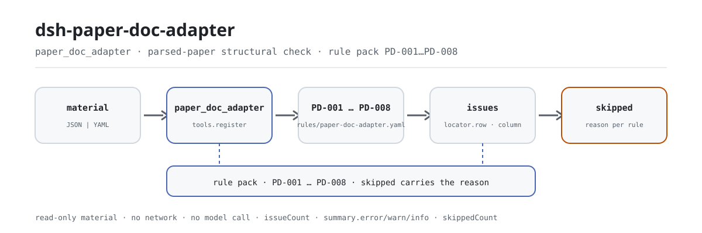

<div align="center">

<picture>
  <source media="(prefers-color-scheme: dark)" srcset="docs/assets/dsh-paper-doc-adapter-flow-dark.svg">
  
</picture>

# dsh-paper-doc-adapter

**पार्स किए गए प्रश्नपत्र की हर असंगति बताता है — कौन-सी पंक्ति, कौन-सा फ़ील्ड, क्या गलत है।**

परीक्षा और शिक्षण प्रशासन के लिए एक स्थानीय जाँच: पार्स किया गया प्रश्नपत्र (शीर्षक पंक्ति और हर प्रश्न की एक पंक्ति) इसे दें, आठ नियम उस परिणाम की संरचनात्मक संगति जाँचते हैं, और आउटपुट ऐसी सूची है जिसे इंगित किया जा सके; सामग्री कभी नहीं बदली जाती और कोई निर्णायक निष्कर्ष नहीं दिया जाता।

[इंस्टॉल](#तीन-चरणों-में-शुरुआत) · [कॉन्फ़िगरेशन](#कॉन्फ़िगरेशन) · [FAQ](#faq) · [简体中文](README.md) · [English](README.en.md) · [Español](README.es.md) · [Português](README.pt.md) · [हिन्दी](README.hi.md)

[](LICENSE)
[](#संगतता)
[](https://www.npmjs.com/package/dsh-paper-doc-adapter)
[](https://github.com/PerryLink/dsh-paper-doc-adapter/actions/workflows/ci.yml)
[](#संगतता)

[](https://github.com/PerryLink/dsh-paper-doc-adapter/stargazers)
[](https://www.npmjs.com/package/dsh-paper-doc-adapter)
[](https://dshfind.com/plugins/PerryLink/dsh-paper-doc-adapter?ref=badge)
[](https://securityscorecards.dev/viewer/?uri=github.com/PerryLink/dsh-paper-doc-adapter)
[](https://dsh.market/)
[](https://gitee.com/perrylink/dsh-paper-doc-adapter)

```sh
dsh plugin --profile <name> add dsh-paper-doc-adapter
```

</div>

<sub>सामुदायिक प्लगइन, DeepSeek से असंबद्ध। कैनोनिकल रिपॉज़िटरी: <https://github.com/PerryLink/dsh-paper-doc-adapter> (Gitee एक मिरर है)।</sub>

## यह क्या है

`dsh-paper-doc-adapter` एक पार्स किया गया प्रश्नपत्र पढ़ता है — प्रश्नपत्र की शीर्षक पंक्ति और हर प्रश्न की एक पंक्ति — और उस पार्स परिणाम की अपनी संरचनात्मक संगति जाँचता है: हर प्रश्न ने अपना क्रमांक और प्रश्न-वाक्य दर्ज किया है या नहीं, उत्तर या व्याख्या में से कम से कम एक मौजूद है या नहीं, प्रश्नों के अंकों का योग शीर्षक में लिखे कुल अंक के बराबर है या नहीं, प्रश्न का प्रकार आपके कॉन्फ़िगर किए शब्दकोश से आता है या नहीं, कठिनाई गुणांक आपकी सीमा में पड़ता है या नहीं, प्रश्न पहचानकर्ता मौजूद और अद्वितीय हैं या नहीं, कोई ज्ञान-बिंदु दर्ज है या नहीं, और प्रश्न-वाक्य में कोई अनदले हुए टेम्पलेट प्लेसहोल्डर बचा है या नहीं। यह केवल सामग्री के भीतर इंगित की जा सकने वाली असंगतियाँ सूचीबद्ध करता है, सामग्री को कभी नहीं बदलता और कोई निर्णायक निष्कर्ष नहीं देता; जो जाँच नहीं चल सकी, वह चुपचाप पास होने के बजाय `skipped` में कारण के साथ दर्ज होती है।

किसके लिए: परीक्षा, प्रश्न-निर्माण और मूल्यांकन प्रशासन — कमांड लाइन की जानकारी ज़रूरी नहीं। आप क्या देते हैं: वही मूल सामग्री जिस पर यह जाँच चलती है (कोई तालिका, रजिस्टर या दस्तावेज़); Excel को पहले JSON/YAML में बदला जा सकता है, चैट में भी अगर प्लेटफ़ॉर्म सहयता दे।

## तीन चरणों में शुरुआत

1. **इंस्टॉल** (npm पर `0.2.10` प्रकाशित है; पैकेज प्रकाशन से पहले बनाया जाता है और npm पैकेज में `lib/` पहले से है):

   ```sh
   # npm चैनल (प्रकाशित संस्करण)
   dsh plugin --profile web add dsh-paper-doc-adapter
   # tarball चैनल: इस रेपो में pnpm pack के बाद
   dsh plugin --profile web add ./dsh-paper-doc-adapter-0.2.10.tgz
   ```

2. **न्यूनतम कॉन्फ़िगरेशन** (डिफ़ॉल्ट चलते हैं; ज़रूरत के अनुसार नियम पैक बदलें या कोई नियम रोकें):

   ```yaml
   - insert:
       - id: dsh-paper-doc-adapter
         name: dsh-paper-doc-adapter
         config:
           rulesFile: rules/paper-doc-adapter.yaml
           disabledRules: [PD-004]
   ```

3. **जाँचें कि सक्रिय है**:

   ```sh
   dsh --profile web --dump-config | grep 'dsh-paper-doc-adapter'
   ```

   आप टूल को सीधे भी बुला सकते हैं: `{"file": "/abs/path/paper.json"}` (या `{"material": "<JSON/YAML टेक्स्ट>"}`) `issueCount`, `summary.error/warn/info`, `skippedCount` और एक markdown रिपोर्ट लौटाता है।

**रेपो में तेज़ परीक्षण (एक मिनट)**: `pnpm install && pnpm run build && node samples/quickstart/run.mjs` — आउटपुट `paper_doc_adapter: 1 issue(s)` और `skipped: 1`। नमूना `samples/quickstart/input/` में, अपेक्षित परिणाम `samples/quickstart/expected/result.json` में, और कैप्चर `docs/assets/quickstart.log` तथा `docs/assets/quickstart.png` में है।

**अनइंस्टॉल**: `dsh plugin --profile web remove dsh-paper-doc-adapter` (या प्रोफ़ाइल पैच से वह पंक्ति हटा दें)।

## मुख्य क्षमताएँ

- **एक सामग्री अंदर, एक असंगति सूची बाहर** — JSON या YAML (शीर्षक पंक्ति और हर प्रश्न की एक पंक्ति) दें; हर असंगति में `ruleId`, `severity`, `locator.row`, `locator.column`, `found` और `expected` होते हैं, इसलिए पढ़ने वाला सीधे पंक्ति और स्तंभ तक पहुँचता है।
- **खाली सूची का अर्थ "कुछ गलत नहीं" नहीं** — जो जाँच नहीं चल सकी, वह `skipped` में कारण के साथ जाती है (`skipNotes` अपना नोट जोड़ता है); कुछ भी चुपचाप पास नहीं होता।
- **नियम पैक डेटा है, कोड नहीं** — `rules/paper-doc-adapter.yaml` बदलने से नियम-समूह बदल जाता है, TypeScript छूने की ज़रूरत नहीं; पैक लोड पर मान्य होता है, उस पर भरोसा नहीं किया जाता।
- **केवल असंगतियाँ, कोई निर्णय नहीं** — यह अनुपालन, दायित्व या सही-गलत पर फ़ैसला नहीं देता और समीक्षक का विकल्प नहीं है; एक शब्द-रक्षक हर रिपोर्ट पर अस्वीकरण बनाए रखता है।
- **प्लगइन ही टूल है** — यह केवल एक टूल, `paper_doc_adapter`, पंजीकृत करता है, और पंजीकरण एक Cordis effect है: अनलोड या हॉट-रीलोड पर वह हट जाता है।

### नियम पैक

| नियम | क्या जाँचता है | गंभीरता | आधार प्रकार |
|---|---|---|---|
| `PD-001` | प्रश्न क्रमांक और प्रश्न-वाक्य दर्ज हैं (दोनों में से कम से कम एक) | warn | principle |
| `PD-002` | उत्तर या व्याख्या मौजूद है (कम से कम एक) | warn | principle |
| `PD-003` | प्रश्नों के अंकों का योग प्रश्नपत्र के कुल अंक के बराबर है | warn | principle |
| `PD-004` | प्रश्न का प्रकार आपके शब्दकोश से आता है (फ़ैक्टरी में बंद) | info | local |
| `PD-005` | कठिनाई गुणांक आपकी सीमा में पड़ता है | info | local |
| `PD-006` | प्रश्न पहचानकर्ता मौजूद और अद्वितीय हैं | warn | principle |
| `PD-007` | कोई ज्ञान-बिंदु दर्ज है | warn | principle |
| `PD-008` | प्रश्न-वाक्य में कोई अनदला प्लेसहोल्डर नहीं | warn | principle |

### सामग्री प्रारूप

टूल JSON या YAML स्वीकार करता है:

```yaml
paperTitle: 某某科目 2026 年模拟试卷
subject: 某某科目
grade: 高二
paperVersion: 2026 版
totalScore: '3'
durationMin: '90'
rows:
  - { 序号: '1', 题号: '1', 题型: 单选题, 题干: 下列关于……的说法，正确的是（　　）,
      选项: A. ……；B. ……；C. ……；D. ……, 答案: B,
      解析: 本题考查……，依据……，故 B 正确。, 分值: '3', 难度: '0.72',
      知识点: 某某章节 某某知识点, 题目ID: YOTTA-2026-0001, 标签: 基础题 }
```

स्तंभ नाम बड़े-छोटे अक्षर, रिक्त स्थान, अंडरस्कोर और हाइफ़न की उपेक्षा करके मिलाए जाते हैं; सामग्री के अपने स्तंभ नाम बने रहते हैं, इसलिए हर निष्कर्ष उसी स्तंभ का नाम बताता है जिसे उसने पढ़ा। ध्यान दें: क्रम-संख्या वाला स्तंभ पंक्ति की प्रदर्शन संख्या के रूप में पढ़ा जाता है — प्रश्न क्रमांक के लिए उसका अपना स्तंभ रखें।

## यह क्या उत्तर देता है

उदाहरण इस रेपो के परीक्षण fixtures से हैं: वास्तविक आउटपुट, कोई चित्रण नहीं। नियम पैक उद्धरण नहीं गढ़ता, इसलिए हर निष्कर्ष उद्धृत धारा का नाम भी बताता है और यह भी लिखता है कि उस धारा का पाठ इस बार प्राप्त नहीं हुआ।

### विस्तृत उदाहरण

**टूल** `paper_doc_adapter`

**इनपुट**

~~~json
{"paperTitle":"某某科目 2026 年模拟试卷","subject":"某某科目","grade":"高二","totalScore":"3","rows":[{"序号":"1","题号":"","题型":"单选题","题干":"","答案":"B","分值":"3"}]}
~~~

**आउटपुट**

~~~json
{
  "id": "dsh-paper-doc-adapter.PD-001.e8d6e3b5",
  "ruleId": "PD-001",
  "severity": "warn",
  "locator": {
    "column": "questionNo",
    "row": 1
  },
  "found": "第 1 行 questionNo、stem 都为空",
  "expected": "questionNo、stem 至少应填写一项",
  "basis": "《试题元数据规范》（JY/T 0606 系列（本次未取得条文）） 关于试题基本信息的条款（本次未取得条号）：「该条文本次未取得：核查未获得该文件的逐字原文，本规则库不伪造引文。」［原则性条款推论，非针对本项的明文要求］",
  "fix": "补填题号与题干；本条只核对是否填写，不判断题目质量"
}
~~~

*Observed from `tests/fixtures/PD-001/PD-001-unsafe.json` और `src/shared/rows.ts` (`presenceAny`)*

### आम प्रश्न

| आप पूछते हैं | यह क्या उत्तर देता है |
|---|---|
| किसी पंक्ति में प्रश्न क्रमांक और प्रश्न-वाक्य दोनों खाली हैं — क्या यह बताता है? | हाँ। `PD-001` उस पंक्ति को बताता है जिसमें `questionNo` और `stem` दोनों खाली हैं, क्योंकि वह दोनों में से कम से कम एक माँगता है। वह केवल यह जाँचता है कि कुछ भरा है या नहीं, यह नहीं कि प्रश्न अच्छा लिखा है या प्रश्न-वाक्य कठोर है। |
| एक प्रश्न में क्रमांक और प्रश्न-वाक्य हैं, पर उत्तर और व्याख्या दोनों नहीं। | `PD-002` उस पंक्ति को बताता है: वह `answer` और `explanation` में से कम से कम एक माँगता है। वह उत्तर के सही होने की जाँच नहीं करता — वह विषय-विशेषज्ञ की समीक्षा है, और पैक स्वयं यही कहता है। |
| प्रश्नों के अंक 98 बनते हैं जबकि शीर्षक 100 कहता है — क्या यह पकड़ में आता है? | हाँ। `PD-003` `score` स्तंभ जोड़कर योग की तुलना शीर्षक में लिखे `totalScore` से करता है, और कॉन्फ़िगर की गई 0.01 सहनशीलता देता है; यदि शीर्षक का कुल अंक पार्स होने योग्य संख्या नहीं है, तो नियम चुपचाप पास होने के बजाय स्वयं को `skipped` में बताता है। वह केवल जोड़ करता है — अंकों का बँटवारा उचित है या नहीं, इस पर फ़ैसला नहीं देता। |
| हमने अपने प्रश्न प्रकार कभी कॉन्फ़िगर नहीं किए। टूल प्रकार स्तंभ का क्या करता है? | `PD-004` स्वयं को `skipped` में बताता है, क्योंकि उसकी `values` सूची खाली आती है: प्रश्न प्रकारों के नाम आपकी संस्था की परिपाटी हैं और इंजन कोई सूची हार्ड-कोड नहीं करता। मूल्य कॉन्फ़िगर करने पर उनके बाहर का `questionType` बताया जाएगा; तब नियम केवल सूची में होने की जाँच करता है और प्रकार-विशिष्ट संरचना जाँच नहीं करता। |
| कठिनाई स्तंभ में एक पंक्ति `1.2` और दूसरी में कोई गैर-संख्यात्मक लेबल है — क्या लौटता है? | `PD-005` उस मान को बताता है जिसे संख्या के रूप में पार्स नहीं किया जा सकता, और उस मान को भी जो कॉन्फ़िगर की गई `min`/`max` सीमा 0–1 के बाहर है। वह सीमा आपकी संस्था की परिपाटी है, एकमात्र मापक्रम नहीं — 1–5 या प्रतिशत के लिए `min`/`max` बदलें या नियम बंद करें। वह केवल सीमा जाँचता है, कभी यह नहीं कि कठिनाई उपयुक्त है, और `info` पर सीमित है। |
| दो प्रश्नों पर एक ही yotta पहचानकर्ता है। यह खाली से बुरा क्यों है? | `PD-006` दोहराया गया मान बताता है, तुलना में रिक्त स्थान छोड़कर, क्योंकि उस पार्स परिणाम को आयात करने से मौजूदा प्रश्न चुपचाप अधिलिखित हो जाएगा; खाली पहचानकर्ता केवल उस एक प्रश्न को बाहर रखता है। कहीं भी पहचानकर्ता न भरा हो तो नियम स्वयं को `skipped` में बताता है। वह उपस्थिति और अद्वितीयता जाँचता है, उससे आगे कुछ नहीं। |

## जिन मानकों का पालन करता है

| दस्तावेज़ | संख्या | इसे उद्धृत करने वाले नियम |
|---|---|---|
| परीक्षा प्रश्न मेटाडेटा विनिर्देश | JY/T 0606 श्रृंखला (इस बार धारा का पाठ प्राप्त नहीं हुआ) | PD-001, PD-002, PD-003, PD-006, PD-007, PD-008 |
| इस संस्था के प्रश्न-बैंक और प्रश्न-निर्माण की परिपाटी (संस्थागत कॉन्फ़िगरेशन) | कोई एकीकृत मानक नहीं (आधार इस संस्था का प्रश्न-प्रकार शब्दकोश है) | PD-004 |
| इस संस्था के प्रश्न-बैंक और प्रश्न-निर्माण की परिपाटी (संस्थागत कॉन्फ़िगरेशन) | कोई एकीकृत मानक नहीं (आधार इस संस्था का कठिनाई मानदंड है) | PD-005 |

**सीमा:** यह प्लगइन **पार्स किए गए परिणाम** की संरचनात्मक संगति जाँचता है — कि हर प्रश्न ने क्रमांक और प्रश्न-वाक्य दर्ज किया है, उत्तर या व्याख्या मौजूद है, प्रश्नों के अंकों का योग प्रश्नपत्र के कुल अंक के बराबर है, प्रकार आपके शब्दकोश से आता है, कठिनाई गुणांक आपकी सीमा में है, पहचानकर्ता मौजूद और अद्वितीय हैं, ज्ञान-बिंदु दर्ज है, और कोई प्लेसहोल्डर नहीं बचा। यह **यह नहीं** तय करता कि प्रश्न अच्छा लिखा है, उत्तर सही है, कठिनाई उपयुक्त है, या प्रश्नपत्र अपने मूल्यांकन लक्ष्यों को पूरा करता है।

> ### ⚠️ यह प्लगइन जानबूझकर क्या नहीं करता
>
> **यह प्रश्नपत्र को एक सामान्य तालिका मानता है और प्रश्न-प्रकार के अनुसार कोई जाँच नहीं करता।** इसलिए यह **यह नहीं जाँचता कि उत्तर का अक्षर दिए गए विकल्पों में है**, न यह कि रिक्त-स्थान प्रश्न में खाली स्थानों की संख्या सही है, न यह कि बहुविकल्पीय प्रश्न में ठीक एक सही विकल्प है। इनके लिए हर प्रश्न-प्रकार की अपनी संरचना पार्स करनी पड़ती है, जिसका यह अडैप्टर प्रयास नहीं करता। यह सीमा पैक के शीर्षक और समस्या निवारण अनुभाग में लिखी है।
>
> **कुंजी की उपस्थिति और अद्वितीयता से आगे यह कभी नहीं जाँचता कि डेटा प्रश्न-बैंक में आयात के योग्य है।** दोहराया पहचानकर्ता खतरनाक स्थिति है — आयात मौजूदा प्रश्न को चुपचाप अधिलिखित कर देगा — इसीलिए `PD-006` `warn` है और इसीलिए पहचानकर्ता स्तंभ न होने पर वह गलत स्तंभ जाँचने के बजाय स्वयं को `skipped` में बताता है।
>
> **कठिनाई सीमा `0–1` स्थानीय परिपाटी है, एकमात्र मापक्रम नहीं।** यह सामान्य परिपाटी है, अधिक मान का अर्थ आसान; 1–5 या प्रतिशत उपयोग करने वाली इकाई `min`/`max` बदल सकती है या नियम बंद कर सकती है।
>
> **नियम पैक का हर `excerpt` स्पष्ट शब्दों में कहता है कि धारा का पाठ इस बार प्राप्त नहीं हुआ** — सत्यापन को न JY/T 0606 का पाठ मिला, न yotta प्लेटफ़ॉर्म का फ़ील्ड विनिर्देश। पाठ मिलने पर हर `excerpt` को वास्तविक धारा से बदलें और `kind` को `direct` तक बढ़ाएँ।

**नियमों का स्रोत:** नियम डेटा `rules/paper-doc-adapter.yaml` में है — उसका शीर्षक बताता है कि प्लगइन क्या नहीं जाँचता, और हर नियम की `note` उस नियम के लिए महत्वपूर्ण हिस्सा दोहराती है। पैक संस्करण-युक्त है (वर्तमान में `2026.1`) और रिपोर्ट उसे `rulesetVersion` के रूप में दिखाती है। लोड-समय का रक्षक अब भी हर नियम के लिए document, clause, excerpt और source माँगता है, और अब भी संस्थागत कॉन्फ़िगरेशन वाली जाँच को `error` चिह्नित करने से रोकता है। `pnpm run check:citations` उद्धरणों की अलग से रखवाली करता है: जो उद्धरण प्राप्त किया जा सकता है वह `rules/evidence/` में शब्दशः मिलना चाहिए, और जो धाराएँ अभी प्राप्त नहीं हुईं वे `rules/citations-baseline.json` में दर्ज होती हैं — यह खाता केवल छोटा हो सकता है।

## कॉन्फ़िगरेशन

हर समायोज्य विकल्प `src/config.ts` के Schemastery स्कीमा में है, इसलिए बिना कोड बदले केवल `cordis.yml` बदलना काफ़ी है; प्रति-नियम सीमाएँ `rules/` के नियम पैक में हैं। आईडी से ओवरराइड करने पर पूरी पंक्ति बदल जाती है — ज़रूरी सभी कुंजियाँ दोहराएँ। `cordis.patch.yml` हर कुंजी को पंक्ति में समझाता है।

सबसे अधिक उपयोग होने वाली कुंजियाँ:

| कुंजी | प्रकार | डिफ़ॉल्ट | विवरण |
|---|---|---|---|
| `rulesFile` | string | `rules/paper-doc-adapter.yaml` | नियम पैक का पथ, पैकेज रूट के सापेक्ष |
| `disabledRules` | string[] | `[]` | रोकने वाले नियम आईडी; हर एक `skipped` में दिखता है |
| `onlyRules` | string[] | `[]` | केवल ये नियम चलाएँ; खाली = सभी नियम |
| `skipNotes` | string | `""` | हर `skipped` कारण के साथ जोड़ा जाने वाला नोट |
| `timeoutMs` | number | `120000` | सहयोगी टूल टाइमआउट बजट |

<details>
<summary>प्रति-नियम पैरामीटर (4 समूह)</summary>

| नियम | पैरामीटर | विवरण |
|---|---|---|
| `PD-003` | `field` / `headerField` / `tolerance` | अंक स्तंभ और शीर्षक का वह कुल जिससे उसे मिलना है; डिफ़ॉल्ट सहनशीलता 0.01 |
| `PD-004` | `values` | आपका प्रश्न-प्रकार शब्दकोश; खाली = कोई जाँच नहीं (नियम `skipped` में जाता है) |
| `PD-005` | `min` / `max` | कठिनाई सीमा, डिफ़ॉल्ट 0 से 1 |
| `PD-008` | `terms` | जो प्लेसहोल्डर खोजे जाते हैं |

</details>

प्रोफ़ाइल पैच ओवरराइड का उदाहरण:

```yaml
- insert:
    - id: dsh-paper-doc-adapter
      name: dsh-paper-doc-adapter
      config:
        disabledRules: [PD-005]
        skipNotes: इस संस्था के कार्यान्वयन नियम देखें
```

## FAQ

<details>
<summary>क्या सामग्री अपलोड होती है? डेटा कहाँ रहता है?</summary>

नहीं। यह पूरी तरह स्थानीय जाँचकर्ता है: यह वही सामग्री पढ़ता है जो आप टूल को देते हैं (`file` या `material`), कोई नेटवर्क अनुरोध नहीं करता, कुछ अपलोड नहीं करता और टेलीमेट्री नहीं भेजता; टूल परिणाम और DSH होस्ट के अपने सत्र/लॉग भंडार के बाहर कुछ नहीं लिखता। वह भंडार होस्ट नियंत्रित करता है, उसका प्रतिधारण भी; यह पैकेज दूसरी प्रति नहीं जोड़ता (देखें `PRIVACY.md`)। पैकेज हटाने से उसका कोड हटता है, पर होस्ट द्वारा पहले लिखे गए सत्र लॉग या आपकी बनाई सामग्री नहीं मिटती।

</details>

<details>
<summary>पूरी तरह अनुरूप सामग्री पर खाली सूची आती है — इसे कैसे पढ़ें?</summary>

खाली `issues` सूची का अर्थ केवल यह है कि "जो जाँच वह चला सका, वे सब पास हुईं"; इसका अर्थ यह **नहीं** कि सामग्री ठीक है। जो जाँच नहीं चल सकी, वह `skipped` में कारण के साथ सूचीबद्ध है, जैसे खाली प्रश्न-प्रकार शब्दकोश वाला `PD-004`, पहचानकर्ता स्तंभ के बिना `PD-006`, या पार्स न होने योग्य शीर्षक कुल वाला `PD-003`। निर्यात की गई सामग्री में स्तंभ अक्सर छूट जाते हैं, इसलिए वे अंतर प्रोग्राम को गिराने के बजाय `skipped` के रूप में आते हैं।

</details>

<details>
<summary>क्या यह अन्य प्लगइनों से टूल नाम, सेवा या रूट के लिए टकराता है?</summary>

नहीं। यह केवल एक टूल, `paper_doc_adapter`, पंजीकृत करता है; कोई सेवा कुंजी नहीं देता, कोई क्लाइंट slot पंजीकृत नहीं करता (इस पैकेज में ब्राउज़र आधा नहीं है), कोई `webServer` उपसर्ग पंजीकृत नहीं करता और कोई ग्लोबल नहीं बदलता; बंडल पैच केवल अपनी पंक्ति `insert` करता है। पंजीकरण Cordis effect है, अनलोड या हॉट रीलोड पर रद्द। बिंदु-दर-बिंदु तर्क «अन्य DSH प्लगइनों के साथ इंटरऑपरेबिलिटी» में है।

</details>

<details>
<summary>प्रदर्शन लागत कितनी है?</summary>

एक स्थानीय फ़ाइल पढ़ना और नियमों का मूल्यांकन: कोई नेटवर्क अनुरोध नहीं, कोई मॉडल कॉल नहीं, कोई डेटाबेस नहीं। आठों नियम सामग्री पर एक-एक बार चलते हैं, और टाइमआउट बजट डिफ़ॉल्ट रूप से `120000` मिलीसेकंड है (`timeoutMs`); पूरी निर्देशिका के लिए `ptc` मोड उपयुक्त है, जहाँ स्कीमा लागत एक बार चुकाई जाती है।

</details>

## सुरक्षा सीमाएँ

- **सामग्री केवल पढ़ी जाती है।** टूल `file` या `material` पढ़कर रिपोर्ट लौटाता है; सामग्री में कभी वापस नहीं लिखता और उसकी दूसरी प्रति नहीं बनाता।
- **कोई नेटवर्क नहीं, कोई मॉडल कॉल नहीं।** नियमों का पूरा मूल्यांकन स्थानीय है (देखें `SECURITY.md` का scope note)।
- **कोई निर्णायक निष्कर्ष नहीं।** रिपोर्ट मानव समीक्षा के लिए अंतर सूचीबद्ध करती है; अनुपालन, दायित्व या सही-गलत पर फ़ैसला नहीं देती, और शब्द-रक्षक हर रिपोर्ट पर अस्वीकरण रखता है।
- **आधार गढ़ा नहीं जाता।** हर नियम में document, number, clause, excerpt, kind और source होते हैं, और `excerpt` शब्दशः उद्धरण होना चाहिए; जहाँ शब्दशः पाठ नहीं मिला वहाँ excerpt यही कहता है और गंभीरता `warn` या `info` पर सीमित रहती है, उद्धरण का रूप नहीं लेती।
- **फ़ेल-क्लोज़्ड।** अधूरी जाँच कभी चुपचाप पास नहीं होती: जब वह नहीं चल सकती तो कारण के साथ `skipped` में जाती है, और केवल संस्थागत कॉन्फ़िगरेशन पर आधारित जाँच को `error` नहीं चिह्नित किया जा सकता।

## ज्ञात सीमाएँ

- **सामान्य तालिका के रूप में व्यवहार; प्रश्न-प्रकार के अनुसार जाँच नहीं।** यह नहीं जाँचता कि उत्तर का अक्षर दिए गए विकल्पों में है, रिक्त स्थानों की संख्या सही है, या बहुविकल्पीय प्रश्न में ठीक एक सही विकल्प है: इनके लिए हर प्रकार की अपनी संरचना पार्स करनी पड़ती है, जिसका यह अडैप्टर प्रयास नहीं करता।
- **कुंजी की उपस्थिति और अद्वितीयता से आगे प्रश्न-बैंक में आयात की योग्यता नहीं जाँची जाती।** दोहराया पहचानकर्ता खतरनाक स्थिति है (आयात मौजूदा प्रश्न को चुपचाप अधिलिखित कर देगा), इसीलिए `PD-006` `warn` है और पहचानकर्ता स्तंभ न होने पर वह गलत स्तंभ जाँचने के बजाय स्वयं को `skipped` में बताता है।
- **कठिनाई सीमा `0–1` स्थानीय परिपाटी है, एकमात्र मापक्रम नहीं।** सामान्य परिपाटी में अधिक मान आसान माने जाते हैं; 1–5 या प्रतिशत उपयोग करने वाली इकाई `min`/`max` बदलती है या नियम बंद करती है। `PD-005` `info` पर सीमित है।
- **प्रश्न-प्रकार सूची खाली आती है।** `PD-004` की `values` खाली होने पर नियम `skipped` में जाता है; इंजन कोई प्रश्न-प्रकार सूची हार्ड-कोड नहीं करता और प्रकार-विशिष्ट संरचना जाँच नहीं करता।
- **नियम पैक का हर `excerpt` बताता है कि धारा का पाठ इस बार प्राप्त नहीं हुआ।** सत्यापन को न JY/T 0606 का शब्दशः पाठ मिला, न yotta का फ़ील्ड विनिर्देश; पाठ मिलने पर हर `excerpt` को वास्तविक धारा से बदलें और `kind` को `direct` तक बढ़ाएँ।

## अन्य DSH प्लगइनों के साथ इंटरऑपरेबिलिटी

- **कोई टूल-नाम टकराव नहीं।** यह केवल `paper_doc_adapter` पंजीकृत करता है और अंतर्निहित टूल या अन्य प्लगइन के किसी नंगे नाम पर दावा नहीं करता।
- **कोई सेवा-कुंजी टकराव नहीं।** यह कोई सेवा कुंजी नहीं देता, इसलिए सेवा-कुंजी की होड़ ही नहीं।
- **कोई slot टकराव नहीं।** यह कोई क्लाइंट slot कुंजी पंजीकृत नहीं करता (यह पैकेज शुद्ध host है, ब्राउज़र आधा नहीं)।
- **कोई HTTP रूट टकराव नहीं।** यह कोई `webServer` उपसर्ग पंजीकृत नहीं करता।
- **कोई पैच-लेयर टकराव नहीं।** `cordis.patch.yml` केवल अपनी पंक्ति `insert` करता है और अंतर्निहित पंक्ति का `config` कभी अधिलिखित नहीं करता।
- **कोई ग्लोबल बदलाव नहीं।** कोई prototype नहीं बदलता, `process.env` नहीं लिखता और ग्लोबल fetch dispatcher नहीं बदलता।

## संगतता

| सतह | स्थिति |
|---|---|
| Harness | पीयर सीमा `>=0.1.2-rc.1 <0.2.0 \|\| >=0.2.0-0 <0.3.0`, `0.2.0-rc.2` और `0.2.1-rc.2` दोनों को स्वीकार करते हुए मापी गई। `engines.dsh` `>=0.2.1-0 <0.3.0` घोषित है और 0.2.1 से होस्ट इसे लागू करता है |
| Node | `^22.19.0 \|\| >=24.0.0` |
| प्लेटफ़ॉर्म | सभी (सादा ESM; कोई नेटिव कोड नहीं, कोई नेटवर्क नहीं, कोई मॉडल कॉल नहीं) |
| टूल मोड | `native` और `ptc` दोनों में चलता है; पूरी निर्देशिका के लिए `ptc` |

## समस्या निवारण

- **उत्तर का अक्षर विकल्पों के बाहर होने पर भी नहीं पकड़ा।** डिज़ाइन के अनुसार: प्लगइन प्रश्नपत्र को सामान्य तालिका मानता है और प्रकार-विशिष्ट सत्यापन नहीं करता।
- **`PD-006` स्वयं को skipped बताता है।** पहचानकर्ता स्तंभ नहीं है, इसलिए अद्वितीयता जाँच के पास कोई कुंजी नहीं। वह गलत स्तंभ जाँचने के बजाय यही बताता है।
- **`PD-005` `1.8` कठिनाई पर चल पड़ता है।** डिफ़ॉल्ट सीमा `0`–`1` है; आपका बैंक दूसरा मापक्रम उपयोग करता हो तो `min`/`max` बदलें।
- **`PD-003` चल पड़ता है जबकि प्रश्नपत्र का जोड़ सही है।** शीर्षक का कुल और पंक्तियों का योग मेल नहीं खाते — सामान्यतः कोई प्रश्न छूटा है या अंक गलत लिखे हैं।
- **`PD-004` कभी नहीं चलता।** उसका शब्दकोश खाली है; अपने बैंक के प्रश्न प्रकार भरें।
- **प्लगइन इंस्टॉल होता है पर टूल दिखता नहीं।** जाँचें कि `main` `lib/index.mjs` की ओर इशारा करता है और `pnpm run build` ने उसे बनाया है; गलत `main` से लोडर प्रविष्टि चुपचाप छोड़ देता है।
- **`dsh plugin add` पैकेज को असंगत कहकर मना करता है।** पीयर सीमा `0.1.x` और `0.2.x` को कवर करती है; यदि आपका रनटाइम उसके बाहर है तो स्पष्ट छूट दें: `dsh plugin --profile <name> allow-version dsh-paper-doc-adapter@0.1.0 --dsh-version <runtime> --accept-risk`.
- **`check` में `manifest-peers` विफल बताया जाता है।** स्थिर जाँचकर्ता 0.2 पंक्ति से पहले की हार्ड-कोड पीयर सीमा से तुलना करता है। रनटाइम इंस्टॉल के समय पीयर संगतता लागू करता है, इसलिए घोषित सीमा सही है; यह `dsh-plugin-dev` की ज्ञात अपस्ट्रीम समस्या है।
- **कोई नियम नहीं चला।** `skipped` सरणी देखें: वह नियम आईडी और कारण बताती है।
- **कोई निष्कर्ष कहता है कि धारा का पाठ इस बार प्राप्त नहीं हुआ।** उद्धरण-रक्षक इसे ईमानदारी से बताता है: इसे सत्यापन की कमी मानें, अनुपालन का प्रमाण नहीं।
- **समय खिसका हुआ लगता है।** सभी गणनाएँ इनपुट स्ट्रिंग पर वॉल-क्लॉक अंकगणित हैं; कोई टाइमज़ोन रूपांतरण नहीं होता।
- **सब कुछ `warn` या `info` है।** डिज़ाइन के अनुसार: यह प्लगइन कानूनी, चिकित्सीय, सीमाशुल्क या सुरक्षा निर्णय नहीं देता; यह अंतर और कमियाँ सूचीबद्ध करता है ताकि कोई व्यक्ति निर्णय ले।

## इकोसिस्टम और गुणवत्ता

- [Gitee मिरर](https://gitee.com/perrylink/dsh-paper-doc-adapter) (सिंक किया गया मिरर; GitHub प्रामाणिक है)
- [dshfind प्लगइन पृष्ठ](https://dshfind.com/plugins/PerryLink/dsh-paper-doc-adapter) (इंस्टॉल संख्या और रैंकिंग)
- [OpenSSF Scorecard रिपोर्ट](https://securityscorecards.dev/viewer/?uri=github.com/PerryLink/dsh-paper-doc-adapter) ([.github/workflows/scorecard.yml](.github/workflows/scorecard.yml) द्वारा संचालित)
- [DSH Market](https://dsh.market/) (सूचीबद्ध)
- **WorkBuddy / Coze चैनल**: «Professional Document Check Suite» खोजें — यह जाँच उसका एक हिस्सा है; उपलब्धता सूची के अनुसार
- [इकोसिस्टम फ़ील्ड-टेस्ट ज्ञानकोश](https://perrylink.github.io/dsh-plugin-guide/): प्लगइन विकास गाइड · चयन मापन · रखरखाव के निर्णय

## डेवलपमेंट

```sh
pnpm install
pnpm run typecheck   # tsc --noEmit
pnpm test            # vitest, साझा टेबल-प्लगइन सूट और जोड़ीदार fixtures
pnpm run build       # tsdown -> lib/index.mjs + lib/index.d.mts
pnpm run verify:self-contained
pnpm run check:lockfile
pnpm run check:readmes
pnpm run check:citations
pnpm pack            # प्रकाशित tarball
```

प्लगइन **केवल डेटा** है: `src/model.ts` तालिका का आकार घोषित करता है, साझा किट पाठक और जाँच इंजन देता है, और नियम पैक हर जाँच घोषित करता है।

| पथ | भूमिका |
|---|---|
| `src/index.ts` | फ़ंक्शन-प्लगइन अनुबंध: `paper_doc_adapter` पंजीकृत करता है और नियम पैक का पथ हल करता है |
| `src/config.ts` | Schemastery स्कीमा, जहाँ हर समायोज्य विकल्प रहता है |
| `src/model.ts` | तालिका का आकार और सामग्री अनुबंध: स्तंभ उपनाम, `parseMaterial`, `runCheck` |
| `src/view.ts` | मॉडल के लिए रिपोर्ट का प्रक्षेपण, `output.schema` का प्रतिबिंब |
| `src/shared/` | साझा किट (`table.ts` पाठक, `rows.ts` जाँच इंजन, नियम लोडर, रिपोर्ट आकार, YAML उपसमुच्चय, कैलेंडर अंकगणित, शब्द-रक्षक), आयात नहीं बल्कि प्रतिलिपि |
| `rules/paper-doc-adapter.yaml` | नियम पैक, आठ नियम |
| `rules/citations-baseline.json` | उद्धरण खाता: जो आज ट्रेस करने योग्य नहीं है उसे दर्ज करता है और केवल छोटा हो सकता है |
| `tests/` | vitest; हर नियम के लिए एक अनुरूप और एक उल्लंघनकारी fixture |

`ACCEPTANCE.csv` `pnpm test` का एक वास्तविक रन दर्ज करता है: 33/33 केस पास, 0 विफल। तेज़ परीक्षण का कैप्चर `docs/assets/quickstart.log` और `docs/assets/quickstart.png` में है।

चित्र [`scripts/gen-readme-assets.py`](scripts/gen-readme-assets.py) से प्रोग्रामेटिक रूप से बनते हैं (Python मानक लाइब्रेरी, SVG आउटपुट, हल्का और गहरा संस्करण) और दोबारा चलाए जा सकते हैं: `python scripts/gen-readme-assets.py`.

## परिवार और आभार

यह प्रोजेक्ट [PerryLink](https://github.com/PerryLink) के DeepSeek Harness प्लगइन परिवार का हिस्सा है (सभी Apache-2.0)। अगर यह उपयोगी लगे, तो **एक स्टार अगले व्यक्ति को इसे खोजने में मदद करता है** — इसके पीछे कुछ भी लॉक नहीं है।

- [@PerryLink](https://github.com/PerryLink) — निर्माता और रखरखावकर्ता: नियम पैक `rules/paper-doc-adapter.yaml`, `paper_doc_adapter` टूल, साझा जाँच-इंजन एकीकरण, और पाँच-भाषा दस्तावेज़।

पूरा परिवार सूचकांक: [सामग्री के अनुसार जाँचकर्ता चुनें](https://perrylink.github.io/zh/checkers/choose/) और [सभी प्लगइन](https://github.com/PerryLink); यह रेपो उनमें से एक है।

<details>
<summary>सभी प्लगइन खोलें</summary>

| प्लगइन | स्थिति |
|---|---|
| **[dsh-aqua-input-check](https://github.com/PerryLink/dsh-aqua-input-check)** |  |
| **[dsh-archive-check](https://github.com/PerryLink/dsh-archive-check)** |  |
| **[dsh-auto-review](https://github.com/PerryLink/dsh-auto-review)** |  |
| **[dsh-autotier](https://github.com/PerryLink/dsh-autotier)** | 🧊 फ़्रोज़न — रेपो README देखें |
| **[dsh-bid-ca-precheck](https://github.com/PerryLink/dsh-bid-ca-precheck)** |  |
| **[dsh-bid-qual-check](https://github.com/PerryLink/dsh-bid-qual-check)** |  |
| **[dsh-cert-mcp](https://github.com/PerryLink/dsh-cert-mcp)** | 🧊 फ़्रोज़न — रेपो README देखें |
| **[dsh-checkpoint-rewind](https://github.com/PerryLink/dsh-checkpoint-rewind)** |  |
| **[dsh-click](https://github.com/PerryLink/dsh-click)** |  |
| **[dsh-composer-history](https://github.com/PerryLink/dsh-composer-history)** |  |
| **[dsh-contract-stance](https://github.com/PerryLink/dsh-contract-stance)** |  |
| **[dsh-customs-doc-check](https://github.com/PerryLink/dsh-customs-doc-check)** |  |
| **[dsh-data-quality](https://github.com/PerryLink/dsh-data-quality)** | 🧊 फ़्रोज़न — रेपो README देखें |
| **[dsh-demurrage-ledger](https://github.com/PerryLink/dsh-demurrage-ledger)** |  |
| **[dsh-doublecheck](https://github.com/PerryLink/dsh-doublecheck)** |  |
| **[dsh-drill-script-check](https://github.com/PerryLink/dsh-drill-script-check)** |  |
| **[dsh-eia-guide-check](https://github.com/PerryLink/dsh-eia-guide-check)** |  |
| **[dsh-emergency-plan](https://github.com/PerryLink/dsh-emergency-plan)** |  |
| **[dsh-essay-rubric-check](https://github.com/PerryLink/dsh-essay-rubric-check)** |  |
| **[dsh-evidence-check](https://github.com/PerryLink/dsh-evidence-check)** |  |
| **[dsh-export-ctl-check](https://github.com/PerryLink/dsh-export-ctl-check)** |  |
| **[dsh-fast](https://github.com/PerryLink/dsh-fast)** |  |
| **[dsh-fmea-table-check](https://github.com/PerryLink/dsh-fmea-table-check)** |  |
| **[dsh-forecast-penalty](https://github.com/PerryLink/dsh-forecast-penalty)** |  |
| **[dsh-fund-research](https://github.com/PerryLink/dsh-fund-research)** |  |
| **[dsh-github](https://github.com/PerryLink/dsh-github)** |  |
| **[dsh-gongwen-flow-check](https://github.com/PerryLink/dsh-gongwen-flow-check)** |  |
| **[dsh-gongwen-word-check](https://github.com/PerryLink/dsh-gongwen-word-check)** |  |
| **[dsh-guard-plan-qc](https://github.com/PerryLink/dsh-guard-plan-qc)** |  |
| **[dsh-hazchem-check](https://github.com/PerryLink/dsh-hazchem-check)** |  |
| **[dsh-hazplan-check](https://github.com/PerryLink/dsh-hazplan-check)** |  |
| **[dsh-hidden-risk-map](https://github.com/PerryLink/dsh-hidden-risk-map)** |  |
| **[dsh-hs-classify](https://github.com/PerryLink/dsh-hs-classify)** |  |
| **[dsh-icd-rule-check](https://github.com/PerryLink/dsh-icd-rule-check)** |  |
| **[dsh-industry-research](https://github.com/PerryLink/dsh-industry-research)** |  |
| **[dsh-lawcite-adapter](https://github.com/PerryLink/dsh-lawcite-adapter)** |  |
| **[dsh-laya](https://github.com/PerryLink/dsh-laya)** |  |
| **[dsh-lc-doc-check](https://github.com/PerryLink/dsh-lc-doc-check)** |  |
| **[dsh-learning-gap-check](https://github.com/PerryLink/dsh-learning-gap-check)** |  |
| **[dsh-library](https://github.com/PerryLink/dsh-library)** |  |
| **[dsh-local-ai](https://github.com/PerryLink/dsh-local-ai)** |  |
| **[dsh-lsp-actions](https://github.com/PerryLink/dsh-lsp-actions)** |  |
| **[dsh-mask](https://github.com/PerryLink/dsh-mask)** |  |
| **[dsh-mcp-panel](https://github.com/PerryLink/dsh-mcp-panel)** |  |
| **[dsh-medrec-qc](https://github.com/PerryLink/dsh-medrec-qc)** |  |
| **[dsh-memento](https://github.com/PerryLink/dsh-memento)** | 🧊 फ़्रोज़न — रेपो README देखें |
| **[dsh-nsfc-form-check](https://github.com/PerryLink/dsh-nsfc-form-check)** |  |
| **[dsh-nurse-record-check](https://github.com/PerryLink/dsh-nurse-record-check)** |  |
| **[dsh-observe](https://github.com/PerryLink/dsh-observe)** |  |
| **[dsh-origin-rvc-check](https://github.com/PerryLink/dsh-origin-rvc-check)** |  |
| **[dsh-ota-review-check](https://github.com/PerryLink/dsh-ota-review-check)** |  |
| **[dsh-output-styles](https://github.com/PerryLink/dsh-output-styles)** |  |
| **[dsh-paper-doc-adapter](https://github.com/PerryLink/dsh-paper-doc-adapter)** |  |
| **[dsh-permission-rules](https://github.com/PerryLink/dsh-permission-rules)** |  |
| **[dsh-permit-report-check](https://github.com/PerryLink/dsh-permit-report-check)** |  |
| **[dsh-pipeline-check](https://github.com/PerryLink/dsh-pipeline-check)** |  |
| **[dsh-pleading-draft](https://github.com/PerryLink/dsh-pleading-draft)** |  |
| **[dsh-plugin-doctor](https://github.com/PerryLink/dsh-plugin-doctor)** | 🚫 रिटायर्ड (रेपो संग्रहीत) |
| **[dsh-plugin-guide](https://github.com/PerryLink/dsh-plugin-guide)** |  |
| **[dsh-plugin-kit](https://github.com/PerryLink/dsh-plugin-kit)** | 🚫 रिटायर्ड (रेपो संग्रहीत) |
| **[dsh-plugin-upgrade](https://github.com/PerryLink/dsh-plugin-upgrade)** | 🚫 रिटायर्ड (रेपो संग्रहीत) |
| **[dsh-policy-brief-draft](https://github.com/PerryLink/dsh-policy-brief-draft)** |  |
| **[dsh-power-loss-split](https://github.com/PerryLink/dsh-power-loss-split)** |  |
| **[dsh-power-ticket-check](https://github.com/PerryLink/dsh-power-ticket-check)** |  |
| **[dsh-ppap-check](https://github.com/PerryLink/dsh-ppap-check)** |  |
| **[dsh-protest-deadline](https://github.com/PerryLink/dsh-protest-deadline)** |  |
| **[dsh-railway-window](https://github.com/PerryLink/dsh-railway-window)** |  |
| **[dsh-repair-order-qc](https://github.com/PerryLink/dsh-repair-order-qc)** |  |
| **[dsh-research-report](https://github.com/PerryLink/dsh-research-report)** |  |
| **[dsh-review-reply-check](https://github.com/PerryLink/dsh-review-reply-check)** |  |
| **[dsh-rulefile-check](https://github.com/PerryLink/dsh-rulefile-check)** |  |
| **[dsh-safety-brief-check](https://github.com/PerryLink/dsh-safety-brief-check)** |  |
| **[dsh-score](https://github.com/PerryLink/dsh-score)** | 🧊 फ़्रोज़न — रेपो README देखें |
| **[dsh-session-sync](https://github.com/PerryLink/dsh-session-sync)** |  |
| **[dsh-site-log-check](https://github.com/PerryLink/dsh-site-log-check)** |  |
| **[dsh-skill-pack-security](https://github.com/PerryLink/dsh-skill-pack-security)** |  |
| **[dsh-soe-decision-check](https://github.com/PerryLink/dsh-soe-decision-check)** |  |
| **[dsh-soilwater-check](https://github.com/PerryLink/dsh-soilwater-check)** |  |
| **[dsh-sop-sync-check](https://github.com/PerryLink/dsh-sop-sync-check)** |  |
| **[dsh-spc-gbt-adapter](https://github.com/PerryLink/dsh-spc-gbt-adapter)** |  |
| **[dsh-talk](https://github.com/PerryLink/dsh-talk)** |  |
| **[dsh-tender-extract](https://github.com/PerryLink/dsh-tender-extract)** |  |
| **[dsh-tender-matrix](https://github.com/PerryLink/dsh-tender-matrix)** |  |
| **[dsh-test-drive](https://github.com/PerryLink/dsh-test-drive)** |  |
| **[dsh-ticktick](https://github.com/PerryLink/dsh-ticktick)** | 🚫 रिटायर्ड (रेपो संग्रहीत) |
| **[dsh-translate](https://github.com/PerryLink/dsh-translate)** |  |
| **[dsh-warranty-calc](https://github.com/PerryLink/dsh-warranty-calc)** |  |
| **[dsh-budget](https://github.com/PerryLink/dsh-budget)** | 🧊 फ़्रोज़न — रेपो README देखें |
| **[dsh-claude-move](https://github.com/PerryLink/dsh-claude-move)** | 🧊 फ़्रोज़न — रेपो README देखें |
| **[dsh-defend](https://github.com/PerryLink/dsh-defend)** | 🧊 फ़्रोज़न — रेपो README देखें |
| **[dsh-draw](https://github.com/PerryLink/dsh-draw)** | 🧊 फ़्रोज़न — रेपो README देखें |
| **[dsh-reach](https://github.com/PerryLink/dsh-reach)** | 🧊 फ़्रोज़न — रेपो README देखें |
| **[dsh-background-agents](https://github.com/PerryLink/dsh-background-agents)** | 🚫 रिटायर्ड (रेपो संग्रहीत) |
| **[dsh-session-pin](https://github.com/PerryLink/dsh-session-pin)** | 🚫 रिटायर्ड (रेपो संग्रहीत) |
| **[dsh-team-rooms](https://github.com/PerryLink/dsh-team-rooms)** | 🚫 रिटायर्ड (रेपो संग्रहीत) |

</details>

## लाइसेंस

[LICENSE](LICENSE) (Apache License 2.0) © 2026 dsh-paper-doc-adapter contributors

<p align="center"><sub>Apache-2.0 · सामुदायिक प्लगइन, DeepSeek से असंबद्ध।</sub></p>
