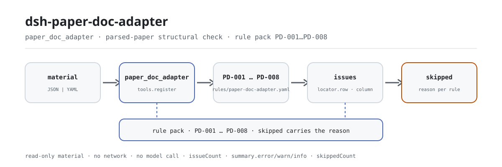

<div align="center">

<picture>
  <source media="(prefers-color-scheme: dark)" srcset="docs/assets/dsh-paper-doc-adapter-flow-dark.svg">
  
</picture>

# dsh-paper-doc-adapter

**逐条报出试卷解析结果里对不上的地方——哪一行、哪一栏、差什么。**

面向教研、命题与阅卷管理的一份本地核对：把试卷解析结果（表头 + 每题一行）交给它，8 条规则核对结构自洽，输出可逐条指认的差异清单；不改原件，也不作出定性结论。

[安装](#三步上手) · [配置](#配置) · [FAQ](#faq) · [简体中文](README.md) · [English](README.en.md) · [Español](README.es.md) · [Português](README.pt.md) · [हिन्दी](README.hi.md)

[](LICENSE)
[](#兼容性)
[](https://www.npmjs.com/package/dsh-paper-doc-adapter)
[](https://github.com/PerryLink/dsh-paper-doc-adapter/actions/workflows/ci.yml)
[](#兼容性)

[](https://github.com/PerryLink/dsh-paper-doc-adapter/stargazers)
[](https://www.npmjs.com/package/dsh-paper-doc-adapter)
[](https://dshfind.com/plugins/PerryLink/dsh-paper-doc-adapter?ref=badge)
[](https://securityscorecards.dev/viewer/?uri=github.com/PerryLink/dsh-paper-doc-adapter)
[](https://dsh.market/)
[](https://gitee.com/perrylink/dsh-paper-doc-adapter)

```sh
dsh plugin --profile <name> add dsh-paper-doc-adapter
```

</div>

<sub>社区插件，与 DeepSeek 官方无关。唯一仓库：<https://github.com/PerryLink/dsh-paper-doc-adapter>（Gitee 为镜像）。</sub>

## 它是什么

`dsh-paper-doc-adapter` 读取一份试卷解析结果——试卷表头加每道题一行——核对这份解析结果自身的结构自洽：每道题是否填写了题号与题干、是否填写了答案或解析、各题分值合计是否等于表头写的试卷总分、题型取值是否出自你配置的口径、难度系数是否落在你配置的范围内、题目标识是否齐备且唯一、是否标注了知识点、题干栏是否残留模板占位符。它只列出材料内部能逐条指认的差异，不改动原件，也不作出任何定性结论；无法执行的检查会在 `skipped` 里逐条说明原因，而不是静默通过。

给谁用：教研、命题与阅卷管理，不用懂命令行。你交什么：这项核对用到的原始材料（表格、清单或文书）；Excel 可先转成 JSON/YAML，对话里也能代转。

## 三步上手

1. **安装**（npm 通道已发布 `0.2.10`；本包发布前需构建，npm 包内已含 `lib/`）：

   ```sh
   # npm 通道（已发布版本）
   dsh plugin --profile web add dsh-paper-doc-adapter
   # tarball 通道：本仓库 pnpm pack 后
   dsh plugin --profile web add ./dsh-paper-doc-adapter-0.2.10.tgz
   ```

2. **最小配置**（默认即可用；按需换规则库或停用某条）：

   ```yaml
   - insert:
       - id: dsh-paper-doc-adapter
         name: dsh-paper-doc-adapter
         config:
           rulesFile: rules/paper-doc-adapter.yaml
           disabledRules: [PD-004]
   ```

3. **验证已生效**：

   ```sh
   dsh --profile web --dump-config | grep 'dsh-paper-doc-adapter'
   ```

   也可以直接调工具：`{"file": "/abs/path/paper.json"}`（或 `{"material": "<JSON/YAML 文本>"}`），返回 `issueCount`、`summary.error/warn/info`、`skippedCount` 与一份 markdown 报告。

**仓内快速试跑（1 分钟）**：`pnpm install && pnpm run build && node samples/quickstart/run.mjs` —— 输出 `paper_doc_adapter: 1 issue(s)`、`skipped: 1`。样例在 `samples/quickstart/input/`，期望结果在 `samples/quickstart/expected/result.json`，记录见 `docs/assets/quickstart.log` 与 `docs/assets/quickstart.png`。

**卸载**：`dsh plugin --profile web remove dsh-paper-doc-adapter`（或从 profile patch 删掉该行）。

## 核心能力

- **一份材料，一份差异清单** —— 输入 JSON 或 YAML（表头 + 每题一行），每条差异带 `ruleId`、`severity`、`locator.row`、`locator.column`、`found`、`expected`，读的人能直接定位到行与栏。
- **空清单不等于"没问题"** —— 任何无法执行的检查都进 `skipped` 并写明原因（`skipNotes` 可附加备注），绝不静默通过。
- **规则是数据，不是代码** —— 换掉 `rules/paper-doc-adapter.yaml` 就换规则集，不必改 TypeScript；规则库在加载期被校验，不被信任。
- **只列差异，不作定性结论** —— 不判合规、不认定责任、不替代审核人；措辞守卫强制报告始终带免责说明。
- **插件即工具** —— 只注册 `paper_doc_adapter` 一个工具，注册即 Cordis effect：卸载或热重载即撤销。

### 规则表

| 规则 | 检查内容 | 级别 | 依据类型 |
|---|---|---|---|
| `PD-001` | 题号与题干已填写（两者至少一项） | warn | principle（原则性条款） |
| `PD-002` | 答案或解析已填写（至少一项） | warn | principle（原则性条款） |
| `PD-003` | 各题分值合计等于试卷总分 | warn | principle（原则性条款） |
| `PD-004` | 题型取值出自你配置的口径（出厂关闭） | info | local（本机构配置） |
| `PD-005` | 难度系数落在你配置的范围内 | info | local（本机构配置） |
| `PD-006` | 题目标识齐备且唯一 | warn | principle（原则性条款） |
| `PD-007` | 知识点已标注 | warn | principle（原则性条款） |
| `PD-008` | 题干栏无未替换的占位符 | warn | principle（原则性条款） |

### 材料格式

工具接受 JSON 或 YAML：

```yaml
paperTitle: 某某科目 2026 年模拟试卷
subject: 某某科目
grade: 高二
paperVersion: 2026 版
totalScore: '3'
durationMin: '90'
rows:
  - { 序号: '1', 题号: '1', 题型: 单选题, 题干: 下列关于……的说法，正确的是（　　）,
      选项: A. ……；B. ……；C. ……；D. ……, 答案: B,
      解析: 本题考查……，依据……，故 B 正确。, 分值: '3', 难度: '0.72',
      知识点: 某某章节 某某知识点, 题目ID: YOTTA-2026-0001, 标签: 基础题 }
```

列名匹配忽略大小写、空格、下划线、连字符；报告沿用材料自己的列名，因此每条发现都写明它读的是哪一栏。注意 `序号` 读作该行的显示序号——题号请给它自己的一栏（`题号`）。

## 它回答什么问题

示例来自本仓测试夹具的真实输出，不是示意图。规则库不伪造引文，因此每条发现都会同时写明所引条款，以及该条款原文本次未取得。

### 详细输出

**工具** `paper_doc_adapter`

**输入**

~~~json
{"paperTitle":"某某科目 2026 年模拟试卷","subject":"某某科目","grade":"高二","totalScore":"3","rows":[{"序号":"1","题号":"","题型":"单选题","题干":"","答案":"B","分值":"3"}]}
~~~

**输出**

~~~json
{
  "id": "dsh-paper-doc-adapter.PD-001.e8d6e3b5",
  "ruleId": "PD-001",
  "severity": "warn",
  "locator": {
    "column": "questionNo",
    "row": 1
  },
  "found": "第 1 行 questionNo、stem 都为空",
  "expected": "questionNo、stem 至少应填写一项",
  "basis": "《试题元数据规范》（JY/T 0606 系列（本次未取得条文）） 关于试题基本信息的条款（本次未取得条号）：「该条文本次未取得：核查未获得该文件的逐字原文，本规则库不伪造引文。」［原则性条款推论，非针对本项的明文要求］",
  "fix": "补填题号与题干；本条只核对是否填写，不判断题目质量"
}
~~~

*Observed from `tests/fixtures/PD-001/PD-001-unsafe.json` 与 `src/shared/rows.ts`（`presenceAny`）*

### 常见问答

| 你会问 | 它怎么答 |
|---|---|
| 某行的题号与题干都是空的，会被报出吗？ | 会。`PD-001` 只要求 `questionNo` 与 `stem` 至少填一项，两项都空才报出该行。它只核对是否填写，不判断题目出得好不好、题干是否严谨。 |
| 一道题有题号和题干，但答案与解析都没有。 | `PD-002` 会报出该行：它要求 `answer` 与 `explanation` 至少填一项。它不核对答案是否正确——那需要学科专家审题，规则库自己也这么写明。 |
| 各题分值加总为 98，表头写的是 100，能查出来吗？ | 能。`PD-003` 把 `score` 栏加总，与试卷表头写的 `totalScore` 相比，允许配置的 0.01 偏差；表头总分不是可解析的数字时，本条报告自己进入 `skipped`，而不是静默通过。它只做加法核对，不判断分值分配是否合理。 |
| 我们还没有配置自己的题型口径，工具会怎么处理题型栏？ | `PD-004` 会报告自己进入 `skipped`：它的 `values` 出厂为空，题型命名属你所在机构的口径，引擎不硬编码任何清单。配置了取值以后，不在册的 `questionType` 会被报出；此时本条只核对是否在册，也不针对题型做结构校验。 |
| 难度栏一行写 `1.2`，一行写 `中等`，会返回什么？ | `PD-005` 会把无法解析为数字的值报出，也会把落在配置范围 0–1 之外的值报出。0–1 是本机构口径、不是唯一刻度——用 1–5 或百分制就改 `min`/`max` 或停用本条。它只核对范围，不判断难度是否恰当，且封顶 `info`。 |
| 两道题用了同一个 yotta 标识，为什么这比空着更糟？ | `PD-006` 会报出重复的值（比较时忽略空白字符），因为导入这份解析结果会静默覆盖已有题目；空标识只是这道题入不了库。整栏都没填时，本条报告自己进入 `skipped`。它只核对齐备与唯一，此外不作判断。 |

## 依据的标准

| 文件 | 文号 | 引用它的规则 |
|---|---|---|
| 《试题元数据规范》 | JY/T 0606 系列（本次未取得条文） | PD-001, PD-002, PD-003, PD-006, PD-007, PD-008 |
| 本机构题库与命题口径（本机构配置） | 无统一标准（本条依据为本机构配置的题型口径） | PD-004 |
| 本机构题库与命题口径（本机构配置） | 无统一标准（本条依据为本机构配置的难度口径） | PD-005 |

**边界：** 本插件核对一份 **试卷解析结果** 的结构自洽——每道题是否记录了题号与题干、是否填写了答案或解析、各题分值合计是否等于试卷总分、题型是否取自你的取值口径、难度系数是否落在你配置的范围内、题目标识是否齐备且唯一、是否标注了知识点，以及是否残留占位符。它**不**判定题目是否写得好、答案是否正确、难度是否恰当，或试卷是否达到其考查目标。

> ### ⚠️ 这个插件刻意不做的事
>
> **它把试卷当作一张通用表格处理，不执行任何针对题型的分项核对。** 因此它**不核对答案字母是否落在所给选项范围内**，不核对填空题的空数是否正确，也不核对选择题是否恰好只有一个正确选项。这些都需要解析每种题型自身的结构，而本适配器并不尝试这样做。这条边界写在规则库库头和排障一节中。
>
> **除了键是否存在及其唯一性之外，它从不核对数据是否适合导入题库。** 重复的标识符是危险情形——导入会静默覆盖已有题目——这就是 `PD-006` 定为 `warn` 的原因，也是在没有标识符列时它会把自己记入 `skipped`、而不是去核对错误列的原因。
>
> **难度区间 `0–1` 是一种本地约定，不是唯一的量表。** 它是常见约定，数值越大表示越容易；使用 1–5 或百分比的单位可以修改 `min`/`max`，或者停用该规则。
>
> **规则库中的每一个 `excerpt` 都明文写着：条款原文本次未取得**——核验环节既没有取得 JY/T 0606 的原文，也没有取得 yotta 平台的字段规范。待取得原文后，请把每个 `excerpt` 换成真实条款，并把 `kind` 提到 `direct`。

**规则来源：** 规则数据在 `rules/paper-doc-adapter.yaml`——库头写明本插件不核对什么，每条规则的 `note` 重复该条最要紧的那部分。规则库是带版本的（当前 `2026.1`），报告以 `rulesetVersion` 体现。加载期的守卫仍要求每条规则带上 document、clause、excerpt 与 source，且仍禁止把本机构配置的检查标成 `error`。`pnpm run check:citations` 另行守住引文：可取得的引文须在 `rules/evidence/` 中逐字可查，尚未取得的条款记入 `rules/citations-baseline.json`，该账本只允许缩小。

## 配置

所有可调项都在 `src/config.ts` 的 Schemastery schema 里，只改 `cordis.yml` 即可生效，无需改代码；逐条阈值在 `rules/` 下的规则库文件里。按 id 覆盖会替换整行——请重述所有需要的键。`cordis.patch.yml` 逐键内联注释。

最常用键：

| 键 | 类型 | 默认值 | 说明 |
|---|---|---|---|
| `rulesFile` | string | `rules/paper-doc-adapter.yaml` | 规则库文件路径，相对插件包根目录 |
| `disabledRules` | string[] | `[]` | 要停用的规则 id；每条都会出现在 `skipped` 中 |
| `onlyRules` | string[] | `[]` | 只执行这些规则 id；留空表示执行全部规则 |
| `skipNotes` | string | `""` | 附加到每条 `skipped` 说明后的备注 |
| `timeoutMs` | number | `120000` | 工具协作式超时预算（毫秒） |

<details>
<summary>规则级参数（4 组）</summary>

| 规则 | 参数 | 说明 |
|---|---|---|
| `PD-003` | `field` / `headerField` / `tolerance` | 分值栏与表头总分的对应关系，默认容差 0.01 |
| `PD-004` | `values` | 你的题型口径；出厂为空 = 不核对（本条进 `skipped`） |
| `PD-005` | `min` / `max` | 难度区间，默认 0 到 1 |
| `PD-008` | `terms` | 要查的占位符列表 |

</details>

profile patch 覆盖示例：

```yaml
- insert:
    - id: dsh-paper-doc-adapter
      name: dsh-paper-doc-adapter
      config:
        disabledRules: [PD-005]
        skipNotes: 见本机构实施细则
```

## FAQ

<details>
<summary>材料会被上传吗？数据存在哪？</summary>

不会。这是纯本地检查器：只读你交给工具的材料（`file` 或 `material`），不联网、不上传、无遥测；除工具结果与 DSH 宿主自身的会话/日志存储外不写任何数据。那份存储由宿主控制、保留期也由宿主决定，本包不额外存第二份（见 `PRIVACY.md`）。移除本包会移除它的代码，但不会删除宿主已有的会话日志或你已创建的材料。

</details>

<details>
<summary>一份完全合规的材料，空清单该怎么读？</summary>

`issues` 为空只说明"它能做的检查都通过了"，**不**等于材料没问题。所有无法执行的检查都在 `skipped` 里逐条列出原因，例如 `PD-004` 题型口径为空、`PD-006` 没有标识列、`PD-003` 表头总分不是可解析的数字。导出的材料常有缺列，所以这类差异会以 `skipped` 出现，而不是让程序崩溃。

</details>

<details>
<summary>会和其他插件抢工具名、服务或路由吗？</summary>

不会。它只注册 `paper_doc_adapter` 一个工具，不提供任何服务键、不注册客户端 slot（本包无浏览器半）、不注册 `webServer` 前缀、不改全局对象；组合包 patch 只 `insert` 自己那一行。注册是 Cordis effect，卸载或热重载即撤销。逐条论证见「与其他 DSH 插件的互操作性」。

</details>

<details>
<summary>性能开销多大？</summary>

本地读文件加规则求值：无网络请求、不调用模型、不写数据库。8 条规则各对材料做一遍判定，超时预算默认 `120000` 毫秒（`timeoutMs`）；批量核对整个目录建议用 `ptc` 模式，schema 成本只付一次。

</details>

## 安全边界

- **只读材料，不改原件。** 工具读到 `file` 或 `material` 后给出报告，不写回材料，也不生成第二份材料副本。
- **不联网、不调用模型。** 规则求值全部在本地完成（见 `SECURITY.md` 的 scope note）。
- **不作出定性结论。** 报告只列差异供人复核，不判定合规、责任或对错；措辞守卫强制报告始终带免责说明。
- **依据不虚构。** 每条规则必须带 document、number、clause、excerpt、kind 与 source，`excerpt` 必须是逐字引文；本次未取得原文的条款在 `excerpt` 里如实写明，并把严重级封顶 `warn` 或 `info`，不冒充引文。
- **失败关闭。** 未实现的检查不会静默通过：无法执行时进 `skipped` 并写明原因；依据仅为本机构配置的检查不得标成 `error`。

## 已知限制

- **按通用表格处理，不做题型分项核对。** 不核对答案字母是否落在选项范围内、填空题的空数是否正确、选择题是否恰好只有一个正确选项——那需要解析题型自身的结构，本适配器不尝试。
- **除键是否存在与唯一性外，不核对能否导入题库。** 重复标识是危险情形（导入会静默覆盖已有题目），所以 `PD-006` 为 `warn`，且没有标识列时报告自己进 `skipped`，而不是去核对错误列。
- **难度区间 `0–1` 是本地约定，不是唯一刻度。** 常见约定里数值越大越容易；用 1–5 或百分制就改 `min`/`max`，或停用该条。`PD-005` 封顶 `info`。
- **题型清单出厂为空。** `PD-004` 的 `values` 为空时本条进 `skipped`；引擎不硬编码任何题型清单，也不针对题型做结构校验。
- **规则库的 `excerpt` 一律写明条款原文本次未取得。** 核验既没有取得 JY/T 0606 的逐字原文，也没有取得 yotta 平台的字段规范；待取得原文后，把每个 `excerpt` 换成真实条款并把 `kind` 提到 `direct`。

## 与其他 DSH 插件的互操作性

- **无工具名冲突。** 只注册 `paper_doc_adapter`，不占用任何已被内置工具或其他插件持有的裸名。
- **无服务键冲突。** 不提供任何服务键，因此不存在服务键竞争。
- **无 slot 冲突。** 不注册客户端 slot key（本包是纯 host 形态，无浏览器半）。
- **无 HTTP 路由冲突。** 不注册任何 `webServer` 前缀。
- **无 patch 层冲突。** `cordis.patch.yml` 只 `insert` 自己那一行，从不覆写内置行的 `config`。
- **无全局改写。** 不改原型、不改写 `process.env`、不替换全局 fetch dispatcher。

## 兼容性

| 维度 | 状态 |
|---|---|
| Harness | peer 范围 `>=0.1.2-rc.1 <0.2.0 \|\| >=0.2.0-0 <0.3.0`；已实测同时接受 `0.2.0-rc.2` 与 `0.2.1-rc.2`。`engines.dsh` 声明为 `>=0.2.1-0 <0.3.0`，自 0.2.1 起由宿主裁决 |
| Node | `^22.19.0 \|\| >=24.0.0` |
| 平台 | 全平台（纯 ESM；无原生代码、无联网、不调用模型） |
| 工具模式 | `native` 与 `ptc` 均可；批量核对整个目录建议 `ptc`，schema 成本只付一次 |

## 排障

- **答案字母在选项之外，没有被报出。** 设计如此：插件把试卷当通用表格，不做题型分项校验。
- **`PD-006` 报告自己是 skipped。** 没有标识列，唯一性检查没有可以挂靠的键。它如实报告这一点，而不是去核对错误的列。
- **`PD-005` 对难度 `1.8` 报出。** 默认区间是 `0`–`1`；题库用别的刻度就改 `min`/`max`。
- **`PD-003` 报出，但试卷其实加得对。** 表头总分与行合计不一致——通常是漏了一道题，或分值抄错。
- **`PD-004` 从不执行。** 它的取值清单为空；填上你题库的题型。
- **插件装上了但工具不出现。** 确认 `main` 指向 `lib/index.mjs` 且 `pnpm run build` 已生成它；`main` 写错会让加载器静默跳过该条目。
- **`dsh plugin add` 报包不兼容。** peer 范围覆盖 `0.1.x` 与 `0.2.x`；运行时在其之外时可显式豁免：`dsh plugin --profile <name> allow-version dsh-paper-doc-adapter@0.1.0 --dsh-version <runtime> --accept-risk`。
- **`check` 报 `manifest-peers` 失败。** 静态检查器比对的是一份早于 0.2 世代的硬编码 peer 范围；安装期的 peer 校验以运行时为准。这是 `dsh-plugin-dev` 的已知上游问题。
- **某条规则没有执行。** 看 `skipped` 数组，其中写明了规则 id 与原因。
- **一条发现写着"条款原文本次未取得"。** 引用门禁如实标注：把它当作核验缺口，不是合规证明。
- **时间看起来偏移。** 全部计算是对输入字符串做墙上时钟运算，不做时区换算。
- **报告里全是 `warn` 或 `info`。** 设计如此：本插件不做法定结论，只列差异与缺口，由人决定怎么处理。

## 生态与质量

- [Gitee 镜像](https://gitee.com/perrylink/dsh-paper-doc-adapter)（同步镜像，以 GitHub 为准）
- [dshfind 插件页](https://dshfind.com/plugins/PerryLink/dsh-paper-doc-adapter)（安装量与排名）
- [OpenSSF Scorecard 报告](https://securityscorecards.dev/viewer/?uri=github.com/PerryLink/dsh-paper-doc-adapter)（由 [.github/workflows/scorecard.yml](.github/workflows/scorecard.yml) 驱动）
- [DSH Market](https://dsh.market/)（已上架）
- **WorkBuddy / 扣子渠道**：搜「职业文档核对全集」，本检查是其中一项；上架以商城为准
- [生态实测知识库](https://perrylink.github.io/dsh-plugin-guide/)：插件开发指南 · 选型实测数据 · 维护取舍判据

## 开发

```sh
pnpm install
pnpm run typecheck   # tsc --noEmit
pnpm test            # vitest，共享表格插件套件 + 每条规则一对夹具
pnpm run build       # tsdown -> lib/index.mjs + lib/index.d.mts
pnpm run verify:self-contained
pnpm run check:lockfile
pnpm run check:readmes
pnpm run check:citations
pnpm pack            # 发布 tarball
```

插件是 **data-only**：`src/model.ts` 声明表格形状，共享件提供读取器与检查引擎，规则库声明每一条检查。

| 路径 | 作用 |
|---|---|
| `src/index.ts` | 函数式插件契约：注册 `paper_doc_adapter`、解析规则库路径 |
| `src/config.ts` | Schemastery schema，所有可调项在此 |
| `src/model.ts` | 表格形状与材料契约：列别名、`parseMaterial`、`runCheck` |
| `src/view.ts` | 面向模型的报告投影，与 `output.schema` 对应 |
| `src/shared/` | 共享件（`table.ts` 读取器、`rows.ts` 检查引擎、规则库加载、报告形状、YAML 子集、日历运算、措辞守卫），复制进来而非外部依赖 |
| `rules/paper-doc-adapter.yaml` | 规则库，8 条规则 |
| `rules/citations-baseline.json` | 引文核验账本：记录当前尚不可追溯的引文，只允许缩小 |
| `tests/` | vitest；每条规则一对合规/违例夹具 |

`ACCEPTANCE.csv` 记录了 `pnpm test` 的一次真实运行：33/33 用例通过、0 个失败用例。快速试跑记录见 `docs/assets/quickstart.log` 与 `docs/assets/quickstart.png`。

配图由 [`scripts/gen-readme-assets.py`](scripts/gen-readme-assets.py) 程序化生成（Python 标准库，纯 SVG 输出，深浅双版），可重复执行：`python scripts/gen-readme-assets.py`。

## 家族与致谢

本项目是 [PerryLink](https://github.com/PerryLink) 维护的 DeepSeek Harness 插件家族成员（全部 Apache-2.0）。如果这个插件帮到了你，**给个 star**——它不解锁任何功能，但会让下一个人更容易找到它。

- [@PerryLink](https://github.com/PerryLink) —— 创建者与维护者：规则包 `rules/paper-doc-adapter.yaml`、`paper_doc_adapter` 工具、共享检查引擎接入与五语文档。

完整家族索引：[按材料选核查器](https://perrylink.github.io/zh/checkers/choose/) 与 [全部插件](https://github.com/PerryLink)；本仓库是其中之一。

<details>
<summary>展开全部插件</summary>

| 插件 | 状态 |
|---|---|
| **[dsh-aqua-input-check](https://github.com/PerryLink/dsh-aqua-input-check)** |  |
| **[dsh-archive-check](https://github.com/PerryLink/dsh-archive-check)** |  |
| **[dsh-auto-review](https://github.com/PerryLink/dsh-auto-review)** |  |
| **[dsh-autotier](https://github.com/PerryLink/dsh-autotier)** | 🧊 已冻结 — 见仓库 README |
| **[dsh-bid-ca-precheck](https://github.com/PerryLink/dsh-bid-ca-precheck)** |  |
| **[dsh-bid-qual-check](https://github.com/PerryLink/dsh-bid-qual-check)** |  |
| **[dsh-cert-mcp](https://github.com/PerryLink/dsh-cert-mcp)** | 🧊 已冻结 — 见仓库 README |
| **[dsh-checkpoint-rewind](https://github.com/PerryLink/dsh-checkpoint-rewind)** |  |
| **[dsh-click](https://github.com/PerryLink/dsh-click)** |  |
| **[dsh-composer-history](https://github.com/PerryLink/dsh-composer-history)** |  |
| **[dsh-contract-stance](https://github.com/PerryLink/dsh-contract-stance)** |  |
| **[dsh-customs-doc-check](https://github.com/PerryLink/dsh-customs-doc-check)** |  |
| **[dsh-data-quality](https://github.com/PerryLink/dsh-data-quality)** | 🧊 已冻结 — 见仓库 README |
| **[dsh-demurrage-ledger](https://github.com/PerryLink/dsh-demurrage-ledger)** |  |
| **[dsh-doublecheck](https://github.com/PerryLink/dsh-doublecheck)** |  |
| **[dsh-drill-script-check](https://github.com/PerryLink/dsh-drill-script-check)** |  |
| **[dsh-eia-guide-check](https://github.com/PerryLink/dsh-eia-guide-check)** |  |
| **[dsh-emergency-plan](https://github.com/PerryLink/dsh-emergency-plan)** |  |
| **[dsh-essay-rubric-check](https://github.com/PerryLink/dsh-essay-rubric-check)** |  |
| **[dsh-evidence-check](https://github.com/PerryLink/dsh-evidence-check)** |  |
| **[dsh-export-ctl-check](https://github.com/PerryLink/dsh-export-ctl-check)** |  |
| **[dsh-fast](https://github.com/PerryLink/dsh-fast)** |  |
| **[dsh-fmea-table-check](https://github.com/PerryLink/dsh-fmea-table-check)** |  |
| **[dsh-forecast-penalty](https://github.com/PerryLink/dsh-forecast-penalty)** |  |
| **[dsh-fund-research](https://github.com/PerryLink/dsh-fund-research)** |  |
| **[dsh-github](https://github.com/PerryLink/dsh-github)** |  |
| **[dsh-gongwen-flow-check](https://github.com/PerryLink/dsh-gongwen-flow-check)** |  |
| **[dsh-gongwen-word-check](https://github.com/PerryLink/dsh-gongwen-word-check)** |  |
| **[dsh-guard-plan-qc](https://github.com/PerryLink/dsh-guard-plan-qc)** |  |
| **[dsh-hazchem-check](https://github.com/PerryLink/dsh-hazchem-check)** |  |
| **[dsh-hazplan-check](https://github.com/PerryLink/dsh-hazplan-check)** |  |
| **[dsh-hidden-risk-map](https://github.com/PerryLink/dsh-hidden-risk-map)** |  |
| **[dsh-hs-classify](https://github.com/PerryLink/dsh-hs-classify)** |  |
| **[dsh-icd-rule-check](https://github.com/PerryLink/dsh-icd-rule-check)** |  |
| **[dsh-industry-research](https://github.com/PerryLink/dsh-industry-research)** |  |
| **[dsh-lawcite-adapter](https://github.com/PerryLink/dsh-lawcite-adapter)** |  |
| **[dsh-laya](https://github.com/PerryLink/dsh-laya)** |  |
| **[dsh-lc-doc-check](https://github.com/PerryLink/dsh-lc-doc-check)** |  |
| **[dsh-learning-gap-check](https://github.com/PerryLink/dsh-learning-gap-check)** |  |
| **[dsh-library](https://github.com/PerryLink/dsh-library)** |  |
| **[dsh-local-ai](https://github.com/PerryLink/dsh-local-ai)** |  |
| **[dsh-lsp-actions](https://github.com/PerryLink/dsh-lsp-actions)** |  |
| **[dsh-mask](https://github.com/PerryLink/dsh-mask)** |  |
| **[dsh-mcp-panel](https://github.com/PerryLink/dsh-mcp-panel)** |  |
| **[dsh-medrec-qc](https://github.com/PerryLink/dsh-medrec-qc)** |  |
| **[dsh-memento](https://github.com/PerryLink/dsh-memento)** | 🧊 已冻结 — 见仓库 README |
| **[dsh-nsfc-form-check](https://github.com/PerryLink/dsh-nsfc-form-check)** |  |
| **[dsh-nurse-record-check](https://github.com/PerryLink/dsh-nurse-record-check)** |  |
| **[dsh-observe](https://github.com/PerryLink/dsh-observe)** |  |
| **[dsh-origin-rvc-check](https://github.com/PerryLink/dsh-origin-rvc-check)** |  |
| **[dsh-ota-review-check](https://github.com/PerryLink/dsh-ota-review-check)** |  |
| **[dsh-output-styles](https://github.com/PerryLink/dsh-output-styles)** |  |
| **[dsh-paper-doc-adapter](https://github.com/PerryLink/dsh-paper-doc-adapter)** |  |
| **[dsh-permission-rules](https://github.com/PerryLink/dsh-permission-rules)** |  |
| **[dsh-permit-report-check](https://github.com/PerryLink/dsh-permit-report-check)** |  |
| **[dsh-pipeline-check](https://github.com/PerryLink/dsh-pipeline-check)** |  |
| **[dsh-pleading-draft](https://github.com/PerryLink/dsh-pleading-draft)** |  |
| **[dsh-plugin-doctor](https://github.com/PerryLink/dsh-plugin-doctor)** | 🚫 已退役（仓库已归档） |
| **[dsh-plugin-guide](https://github.com/PerryLink/dsh-plugin-guide)** |  |
| **[dsh-plugin-kit](https://github.com/PerryLink/dsh-plugin-kit)** | 🚫 已退役（仓库已归档） |
| **[dsh-plugin-upgrade](https://github.com/PerryLink/dsh-plugin-upgrade)** | 🚫 已退役（仓库已归档） |
| **[dsh-policy-brief-draft](https://github.com/PerryLink/dsh-policy-brief-draft)** |  |
| **[dsh-power-loss-split](https://github.com/PerryLink/dsh-power-loss-split)** |  |
| **[dsh-power-ticket-check](https://github.com/PerryLink/dsh-power-ticket-check)** |  |
| **[dsh-ppap-check](https://github.com/PerryLink/dsh-ppap-check)** |  |
| **[dsh-protest-deadline](https://github.com/PerryLink/dsh-protest-deadline)** |  |
| **[dsh-railway-window](https://github.com/PerryLink/dsh-railway-window)** |  |
| **[dsh-repair-order-qc](https://github.com/PerryLink/dsh-repair-order-qc)** |  |
| **[dsh-research-report](https://github.com/PerryLink/dsh-research-report)** |  |
| **[dsh-review-reply-check](https://github.com/PerryLink/dsh-review-reply-check)** |  |
| **[dsh-rulefile-check](https://github.com/PerryLink/dsh-rulefile-check)** |  |
| **[dsh-safety-brief-check](https://github.com/PerryLink/dsh-safety-brief-check)** |  |
| **[dsh-score](https://github.com/PerryLink/dsh-score)** | 🧊 已冻结 — 见仓库 README |
| **[dsh-session-sync](https://github.com/PerryLink/dsh-session-sync)** |  |
| **[dsh-site-log-check](https://github.com/PerryLink/dsh-site-log-check)** |  |
| **[dsh-skill-pack-security](https://github.com/PerryLink/dsh-skill-pack-security)** |  |
| **[dsh-soe-decision-check](https://github.com/PerryLink/dsh-soe-decision-check)** |  |
| **[dsh-soilwater-check](https://github.com/PerryLink/dsh-soilwater-check)** |  |
| **[dsh-sop-sync-check](https://github.com/PerryLink/dsh-sop-sync-check)** |  |
| **[dsh-spc-gbt-adapter](https://github.com/PerryLink/dsh-spc-gbt-adapter)** |  |
| **[dsh-talk](https://github.com/PerryLink/dsh-talk)** |  |
| **[dsh-tender-extract](https://github.com/PerryLink/dsh-tender-extract)** |  |
| **[dsh-tender-matrix](https://github.com/PerryLink/dsh-tender-matrix)** |  |
| **[dsh-test-drive](https://github.com/PerryLink/dsh-test-drive)** |  |
| **[dsh-ticktick](https://github.com/PerryLink/dsh-ticktick)** | 🚫 已退役（仓库已归档） |
| **[dsh-translate](https://github.com/PerryLink/dsh-translate)** |  |
| **[dsh-warranty-calc](https://github.com/PerryLink/dsh-warranty-calc)** |  |
| **[dsh-budget](https://github.com/PerryLink/dsh-budget)** | 🧊 已冻结 — 见仓库 README |
| **[dsh-claude-move](https://github.com/PerryLink/dsh-claude-move)** | 🧊 已冻结 — 见仓库 README |
| **[dsh-defend](https://github.com/PerryLink/dsh-defend)** | 🧊 已冻结 — 见仓库 README |
| **[dsh-draw](https://github.com/PerryLink/dsh-draw)** | 🧊 已冻结 — 见仓库 README |
| **[dsh-reach](https://github.com/PerryLink/dsh-reach)** | 🧊 已冻结 — 见仓库 README |
| **[dsh-background-agents](https://github.com/PerryLink/dsh-background-agents)** | 🚫 已退役（仓库已归档） |
| **[dsh-session-pin](https://github.com/PerryLink/dsh-session-pin)** | 🚫 已退役（仓库已归档） |
| **[dsh-team-rooms](https://github.com/PerryLink/dsh-team-rooms)** | 🚫 已退役（仓库已归档） |

</details>

## License

[LICENSE](LICENSE)（Apache License 2.0）© 2026 dsh-paper-doc-adapter contributors

<p align="center"><sub>Apache-2.0 · 社区插件，与 DeepSeek 无关。</sub></p>
