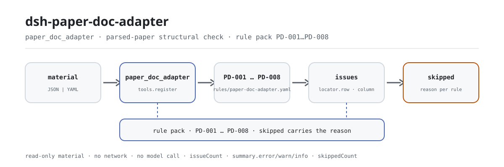

<div align="center">

<picture>
  <source media="(prefers-color-scheme: dark)" srcset="docs/assets/dsh-paper-doc-adapter-flow-dark.svg">
  
</picture>

# dsh-paper-doc-adapter

**Reporta cada divergência de uma prova já parseada: qual linha, qual campo, o que está errado.**

Uma verificação local para coordenação pedagógica e de provas: você entrega uma prova parseada (cabeçalho mais uma linha por questão), oito regras testam a coerência estrutural do resultado e a saída é uma lista apontável; o material nunca é alterado e nenhum veredito é emitido.

[Instalar](#instalação-em-três-passos) · [Configuração](#configuração) · [FAQ](#faq) · [简体中文](README.md) · [English](README.en.md) · [Español](README.es.md) · [Português](README.pt.md) · [हिन्दी](README.hi.md)

[](LICENSE)
[](#compatibilidade)
[](https://www.npmjs.com/package/dsh-paper-doc-adapter)
[](https://github.com/PerryLink/dsh-paper-doc-adapter/actions/workflows/ci.yml)
[](#compatibilidade)

[](https://github.com/PerryLink/dsh-paper-doc-adapter/stargazers)
[](https://www.npmjs.com/package/dsh-paper-doc-adapter)
[](https://dshfind.com/plugins/PerryLink/dsh-paper-doc-adapter?ref=badge)
[](https://securityscorecards.dev/viewer/?uri=github.com/PerryLink/dsh-paper-doc-adapter)
[](https://dsh.market/)
[](https://gitee.com/perrylink/dsh-paper-doc-adapter)

```sh
dsh plugin --profile <name> add dsh-paper-doc-adapter
```

</div>

<sub>Plugin da comunidade, sem afiliação com a DeepSeek. Repositório canônico: <https://github.com/PerryLink/dsh-paper-doc-adapter> (o Gitee é um espelho).</sub>

## O que é

O `dsh-paper-doc-adapter` lê uma prova parseada — o cabeçalho da prova mais uma linha por questão — e verifica a coerência estrutural desse resultado: se cada questão registra número e enunciado, se há resposta ou explicação, se a soma das pontuações iguala o total declarado no cabeçalho, se o tipo de questão vem do vocabulário que você configurar, se o coeficiente de dificuldade cai dentro da sua faixa, se os identificadores estão presentes e são únicos, se há um ponto de conhecimento registrado e se não sobrou nenhum marcador de modelo no enunciado. Ele apenas lista divergências apontáveis dentro do material, nunca altera o material e não emite veredito; toda verificação que não pôde rodar é informada em `skipped` com o motivo, em vez de passar em silêncio.

Para quem é: coordenação pedagógica, de elaboração de provas e de correção — sem precisar de linha de comando. O que você entrega: o material de origem sobre o qual a verificação trabalha (uma tabela, um registro ou um documento); o Excel pode ser convertido antes para JSON/YAML, inclusive no chat se a plataforma permitir.

## Instalação em três passos

1. **Instalar** (`0.2.10` está publicada no npm; o pacote é compilado antes de publicar e o pacote npm já contém `lib/`):

   ```sh
   # canal npm (versões publicadas)
   dsh plugin --profile web add dsh-paper-doc-adapter
   # canal tarball: pnpm pack neste repositório e depois
   dsh plugin --profile web add ./dsh-paper-doc-adapter-0.2.10.tgz
   ```

2. **Configuração mínima** (os padrões funcionam; troque o pacote de regras ou pare uma regra conforme a necessidade):

   ```yaml
   - insert:
       - id: dsh-paper-doc-adapter
         name: dsh-paper-doc-adapter
         config:
           rulesFile: rules/paper-doc-adapter.yaml
           disabledRules: [PD-004]
   ```

3. **Verificar que está ativo**:

   ```sh
   dsh --profile web --dump-config | grep 'dsh-paper-doc-adapter'
   ```

   Você também pode chamar a ferramenta direto: `{"file": "/abs/path/paper.json"}` (ou `{"material": "<texto JSON/YAML>"}`) devolve `issueCount`, `summary.error/warn/info`, `skippedCount` e um relatório em markdown.

**Teste rápido no repositório (um minuto)**: `pnpm install && pnpm run build && node samples/quickstart/run.mjs` imprime `paper_doc_adapter: 1 issue(s)` e `skipped: 1`. O exemplo fica em `samples/quickstart/input/`, o resultado esperado em `samples/quickstart/expected/result.json` e a captura em `docs/assets/quickstart.log` e `docs/assets/quickstart.png`.

**Desinstalar**: `dsh plugin --profile web remove dsh-paper-doc-adapter` (ou apague a linha do patch do perfil).

## Capacidades principais

- **Um material entra, uma lista de divergências sai** — recebe JSON ou YAML (cabeçalho mais uma linha por questão); cada divergência traz `ruleId`, `severity`, `locator.row`, `locator.column`, `found` e `expected`, então quem lê vai direto à linha e à coluna.
- **Lista vazia não significa "nada errado"** — toda verificação que não pôde rodar vai para `skipped` com o motivo (`skipNotes` acrescenta uma nota sua); nada passa em silêncio.
- **O pacote de regras é dado, não código** — trocar `rules/paper-doc-adapter.yaml` troca o conjunto de regras sem tocar em TypeScript; o pacote é validado na carga, não é confiado.
- **Só divergências, sem veredito** — não decide conformidade, responsabilidade nem acerto, e não substitui o revisor; um guardião de redação mantém o aviso em todo relatório.
- **O plugin é a ferramenta** — registra uma única ferramenta, `paper_doc_adapter`, e o registro é um efeito do Cordis: descarregar ou recarregar a quente o revoga.

### Pacote de regras

| Regra | O que verifica | Severidade | Tipo de base |
|---|---|---|---|
| `PD-001` | o número e o enunciado estão registrados (pelo menos um dos dois) | warn | principle |
| `PD-002` | há resposta ou explicação (pelo menos uma) | warn | principle |
| `PD-003` | a soma das pontuações iguala o total da prova | warn | principle |
| `PD-004` | o tipo de questão vem do seu vocabulário (desligada de fábrica) | info | local |
| `PD-005` | o coeficiente de dificuldade cai dentro da sua faixa | info | local |
| `PD-006` | os identificadores estão presentes e são únicos | warn | principle |
| `PD-007` | há um ponto de conhecimento registrado | warn | principle |
| `PD-008` | o enunciado não guarda marcadores não substituídos | warn | principle |

### Formato do material

A ferramenta aceita JSON ou YAML:

```yaml
paperTitle: 某某科目 2026 年模拟试卷
subject: 某某科目
grade: 高二
paperVersion: 2026 版
totalScore: '3'
durationMin: '90'
rows:
  - { 序号: '1', 题号: '1', 题型: 单选题, 题干: 下列关于……的说法，正确的是（　　）,
      选项: A. ……；B. ……；C. ……；D. ……, 答案: B,
      解析: 本题考查……，依据……，故 B 正确。, 分值: '3', 难度: '0.72',
      知识点: 某某章节 某某知识点, 题目ID: YOTTA-2026-0001, 标签: 基础题 }
```

Os nomes de coluna são comparados ignorando maiúsculas e minúsculas e desconsiderando espaços, sublinhados e hifens; os nomes próprios do material são preservados, então cada achado nomeia a coluna que leu. Atenção: a coluna de número de ordem é lida como o número de exibição da linha — dê ao número da questão a sua própria coluna.

## O que ele responde

Os exemplos vêm dos fixtures de teste deste repositório: saída real, não ilustração. O pacote de regras não fabrica citações, por isso cada achado também nomeia a cláusula citada e registra que o texto dela não foi obtido.

### Exemplo detalhado

**Ferramenta** `paper_doc_adapter`

**Entrada**

~~~json
{"paperTitle":"某某科目 2026 年模拟试卷","subject":"某某科目","grade":"高二","totalScore":"3","rows":[{"序号":"1","题号":"","题型":"单选题","题干":"","答案":"B","分值":"3"}]}
~~~

**Saída**

~~~json
{
  "id": "dsh-paper-doc-adapter.PD-001.e8d6e3b5",
  "ruleId": "PD-001",
  "severity": "warn",
  "locator": {
    "column": "questionNo",
    "row": 1
  },
  "found": "第 1 行 questionNo、stem 都为空",
  "expected": "questionNo、stem 至少应填写一项",
  "basis": "《试题元数据规范》（JY/T 0606 系列（本次未取得条文）） 关于试题基本信息的条款（本次未取得条号）：「该条文本次未取得：核查未获得该文件的逐字原文，本规则库不伪造引文。」［原则性条款推论，非针对本项的明文要求］",
  "fix": "补填题号与题干；本条只核对是否填写，不判断题目质量"
}
~~~

*Observed from `tests/fixtures/PD-001/PD-001-unsafe.json` e `src/shared/rows.ts` (`presenceAny`)*

### Perguntas comuns

| Você pergunta | O que ele responde |
|---|---|
| O número e o enunciado estão vazios numa linha — ele avisa? | Sim. `PD-001` reporta a linha cujo `questionNo` e `stem` estão ambos vazios, porque pede pelo menos um dos dois. Ele verifica que algo esteja preenchido, não se a questão está bem redigida ou se o enunciado é rigoroso. |
| Uma questão tem número e enunciado, mas nem resposta nem explicação. | `PD-002` reporta essa linha: pede pelo menos um entre `answer` e `explanation`. Não verifica se a resposta está correta — isso é revisão de especialista da disciplina, e o próprio pacote diz isso. |
| As pontuações somam 98 e o cabeçalho diz 100 — isso é pego? | Sim. `PD-003` soma a coluna `score` e compara o total com o `totalScore` declarado no cabeçalho, com a tolerância configurada de 0.01; se o total do cabeçalho não for um número parseável, a regra se reporta em `skipped` em vez de passar. Ela só faz a soma: não julga se as pontuações estão bem distribuídas. |
| Nunca configuramos nossos tipos de questão. O que ele faz com a coluna de tipo? | `PD-004` se reporta em `skipped`, porque a lista `values` vem vazia: nomear tipos de questão é convenção da sua instituição e o motor não codifica lista nenhuma. Quando você configurar os valores, um `questionType` fora deles é reportado; a regra então verifica só pertinência e não faz validação estrutural por tipo. |
| A coluna de dificuldade traz `1.2` numa linha e um rótulo não numérico em outra — o que volta? | `PD-005` reporta o valor que não consegue interpretar como número e o valor fora da faixa `min`/`max` configurada de 0–1. Essa faixa é convenção da sua instituição, não a única escala: com 1–5 ou porcentagem é preciso mudar `min`/`max` ou desligar a regra. Ela verifica só a faixa, nunca se a dificuldade é adequada, e fica limitada a `info`. |
| Duas questões usam o mesmo identificador yotta. Por que isso é pior que um vazio? | `PD-006` reporta o valor repetido, comparando sem espaços, porque importar esse resultado sobrescreveria em silêncio uma questão existente; identificador vazio só deixa aquela questão fora. Se nenhum identificador estiver preenchido, a regra se reporta em `skipped`. Ela verifica presença e unicidade, e nada além disso. |

## Normas que segue

| Documento | Número | Regras que o citam |
|---|---|---|
| Especificação de metadados de questões de prova | série JY/T 0606 (texto da cláusula não obtido desta vez) | PD-001, PD-002, PD-003, PD-006, PD-007, PD-008 |
| Critérios de banco de questões e elaboração desta instituição (configuração institucional) | Sem norma unificada (a base é o vocabulário de tipos de questão desta instituição) | PD-004 |
| Critérios de banco de questões e elaboração desta instituição (configuração institucional) | Sem norma unificada (a base é o critério de dificuldade desta instituição) | PD-005 |

**Limite:** este plugin verifica a **coerência estrutural de um resultado de parseamento** — se cada questão registra número e enunciado, se há resposta ou explicação, se a soma das pontuações iguala o total da prova, se o tipo vem do seu vocabulário, se o coeficiente de dificuldade cai na sua faixa, se os identificadores estão presentes e são únicos, se há ponto de conhecimento e se não sobrou marcador. Ele **não** decide se uma questão está bem redigida, se uma resposta está correta, se a dificuldade é adequada ou se a prova cumpre seus objetivos de avaliação.

> ### ⚠️ O que este plugin deliberadamente não faz
>
> **Ele trata a prova como uma tabela genérica e não executa nenhuma verificação específica por tipo de questão.** Por isso **não verifica se a letra da resposta está entre as opções oferecidas**, nem se uma lacuna tem o número certo de espaços, nem se uma questão de múltipla escolha tem exatamente uma opção correta. Isso exige parsear a estrutura de cada tipo de questão, e este adaptador não tenta. Esse limite está escrito no cabeçalho do pacote e na seção de solução de problemas.
>
> **Nunca verifica se os dados servem para importar num banco de questões além da presença e da unicidade das chaves.** Identificador duplicado é o caso perigoso — a importação sobrescreveria em silêncio uma questão existente — e é por isso que `PD-006` é `warn` e por que ele se reporta em `skipped` quando não há coluna de identificador, em vez de verificar a coluna errada.
>
> **A faixa de dificuldade `0–1` é convenção local, não a única escala.** É a convenção comum, com valores maiores significando mais fácil; uma unidade que use 1–5 ou porcentagem pode mudar `min`/`max` ou desligar a regra.
>
> **Cada `excerpt` do pacote de regras diz, com todas as letras, que o texto da cláusula não foi obtido** — a verificação não conseguiu nem o texto da JY/T 0606 nem a especificação de campos da plataforma yotta. Quando tiver os textos, troque cada `excerpt` pela cláusula real e eleve `kind` para `direct`.

**Origem das regras:** os dados ficam em `rules/paper-doc-adapter.yaml` — o cabeçalho dele explica o que o plugin não verifica e a `note` de cada regra repete a parte que importa para aquela regra. O pacote é versionado (atualmente `2026.1`) e o relatório o reflete como `rulesetVersion`. O guardião de carga continua exigindo documento, cláusula, trecho e fonte por regra, e continua proibindo que uma verificação de configuração institucional seja `error`. `pnpm run check:citations` vigia as citações à parte: uma citação obtenível precisa ser encontrável literalmente em `rules/evidence/`, e as cláusulas ainda não obtidas ficam em `rules/citations-baseline.json`, um livro que só pode encolher.

## Configuração

Tudo o que é ajustável fica no esquema Schemastery de `src/config.ts`, então basta mudar `cordis.yml` sem tocar em código; os limites por regra ficam no pacote de regras em `rules/`. Sobrescrever por id substitui a linha inteira: repita todas as chaves de que precisa. O `cordis.patch.yml` documenta cada chave em linha.

As chaves mais usadas:

| Chave | Tipo | Padrão | Descrição |
|---|---|---|---|
| `rulesFile` | string | `rules/paper-doc-adapter.yaml` | Caminho do pacote de regras, relativo à raiz do pacote |
| `disabledRules` | string[] | `[]` | Ids de regra a parar; cada um aparece em `skipped` |
| `onlyRules` | string[] | `[]` | Rodar só estes ids; vazio roda todas |
| `skipNotes` | string | `""` | Nota acrescentada a cada motivo de `skipped` |
| `timeoutMs` | number | `120000` | Orçamento de timeout cooperativo |

<details>
<summary>Parâmetros por regra (4 grupos)</summary>

| Regra | Parâmetros | Descrição |
|---|---|---|
| `PD-003` | `field` / `headerField` / `tolerance` | A coluna de pontuação e o total do cabeçalho com que ela deve coincidir; tolerância padrão 0.01 |
| `PD-004` | `values` | Seu vocabulário de tipos de questão; vazio = sem verificação (a regra entra em `skipped`) |
| `PD-005` | `min` / `max` | A faixa de dificuldade, de 0 a 1 por padrão |
| `PD-008` | `terms` | Os marcadores procurados |

</details>

Exemplo de sobrescrita no patch do perfil:

```yaml
- insert:
    - id: dsh-paper-doc-adapter
      name: dsh-paper-doc-adapter
      config:
        disabledRules: [PD-005]
        skipNotes: ver as regras internas desta instituição
```

## FAQ

<details>
<summary>O material é enviado para algum lugar? Onde ficam os dados?</summary>

Não. É um verificador puramente local: lê o material que você entrega à ferramenta (`file` ou `material`) e não faz requisições de rede, não envia nada e não tem telemetria; não grava dados fora do resultado da ferramenta e do armazenamento de sessão/logs do próprio host DSH. Esse armazenamento é controlado pelo host, e a retenção também; este pacote não acrescenta uma segunda cópia (veja `PRIVACY.md`). Remover o pacote remove o código, mas não apaga logs de sessão que o host já gravou nem material que você já criou.

</details>

<details>
<summary>Um material totalmente conforme devolve lista vazia — como ler isso?</summary>

Uma lista `issues` vazia significa apenas "passaram todas as verificações que ele podia rodar"; **não** significa que o material está certo. Toda verificação que não pôde rodar aparece em `skipped` com o motivo, por exemplo `PD-004` com vocabulário vazio, `PD-006` sem coluna de identificador ou `PD-003` com total de cabeçalho que não é número parseável. Material exportado costuma ter colunas faltando, então essas diferenças aparecem como `skipped` em vez de quebrar o programa.

</details>

<details>
<summary>Ele disputa nomes de ferramenta, serviços ou rotas com outros plugins?</summary>

Não. Registra uma única ferramenta, `paper_doc_adapter`; não oferece chaves de serviço, não registra slots de cliente (este pacote não tem metade de navegador), não registra prefixos `webServer` e não reescreve globais; o patch do bundle apenas insere a própria linha. O registro é um efeito do Cordis, revogado ao descarregar ou recarregar. O argumento ponto a ponto está em «Interoperabilidade com outros plugins DSH».

</details>

<details>
<summary>Qual é o custo de desempenho?</summary>

Uma leitura local de arquivo mais a avaliação das regras: sem requisições de rede, sem chamadas ao modelo, sem banco de dados. Cada uma das oito regras faz uma passada sobre o material, e o orçamento de timeout é de `120000` milissegundos por padrão (`timeoutMs`); para um diretório inteiro vale usar o modo `ptc`, em que o custo do esquema é pago uma vez.

</details>

## Limites de segurança

- **Material somente leitura.** A ferramenta lê `file` ou `material` e devolve um relatório; nunca regrava o material nem cria uma segunda cópia dele.
- **Sem rede e sem chamadas ao modelo.** Toda a avaliação de regras acontece localmente (veja a nota de escopo em `SECURITY.md`).
- **Sem veredito.** O relatório lista divergências para revisão humana; não decide conformidade, responsabilidade nem acerto, e um guardião de redação mantém o aviso em todo relatório.
- **Base não fabricada.** Cada regra traz documento, número, cláusula, trecho, tipo e fonte, e o `excerpt` precisa ser citação literal; quando o texto literal não pôde ser obtido, o trecho diz isso e a severidade fica limitada a `warn` ou `info` em vez de se passar por citação.
- **Falha fechada.** Verificação não implementada nunca passa em silêncio: quando não pode rodar entra em `skipped` com o motivo, e uma verificação baseada só em configuração institucional não pode ser marcada como `error`.

## Limitações conhecidas

- **Tratada como tabela genérica; sem verificação específica por tipo de questão.** Não verifica se a letra da resposta está entre as opções oferecidas, se uma lacuna tem o número certo de espaços ou se uma questão de múltipla escolha tem exatamente uma opção correta: isso exige parsear a estrutura de cada tipo, e este adaptador não tenta.
- **Além da presença e da unicidade das chaves, não verifica a aptidão para importar no banco.** Identificador duplicado é o caso perigoso (a importação sobrescreveria em silêncio uma questão existente), por isso `PD-006` é `warn` e por isso ele se reporta em `skipped` quando não há coluna de identificador, em vez de verificar a coluna errada.
- **A faixa de dificuldade `0–1` é convenção local, não a única escala.** Na convenção comum um valor maior significa mais fácil; uma unidade que use 1–5 ou porcentagem muda `min`/`max` ou desliga a regra. `PD-005` fica limitada a `info`.
- **A lista de tipos de questão vem vazia.** Com `values` do `PD-004` vazio, a regra entra em `skipped`; o motor não codifica lista de tipos nem faz validação estrutural por tipo.
- **Cada `excerpt` do pacote indica que o texto da cláusula não foi obtido desta vez.** A verificação não obteve o texto literal da JY/T 0606 nem a especificação de campos da yotta; quando tiver, troque cada `excerpt` pela cláusula real e eleve `kind` para `direct`.

## Interoperabilidade com outros plugins DSH

- **Sem colisão de nome de ferramenta.** Registra apenas `paper_doc_adapter`, sem tomar nenhum nome nu já ocupado por ferramenta nativa ou outro plugin.
- **Sem colisão de chave de serviço.** Não oferece nenhuma chave de serviço, então não há disputa por chaves.
- **Sem colisão de slot.** Não registra chaves de slot de cliente (este pacote é host puro, sem metade de navegador).
- **Sem colisão de rota HTTP.** Não registra nenhum prefixo `webServer`.
- **Sem colisão de camada de patch.** O `cordis.patch.yml` só faz `insert` da própria linha e nunca sobrescreve o `config` de uma linha nativa.
- **Sem reescrita global.** Não altera protótipos, não reescreve `process.env` e não substitui o dispatcher global de fetch.

## Compatibilidade

| Superfície | Estado |
|---|---|
| Harness | Faixa de pares `>=0.1.2-rc.1 <0.2.0 \|\| >=0.2.0-0 <0.3.0`, medida para aceitar tanto `0.2.0-rc.2` como `0.2.1-rc.2`. `engines.dsh` é declarado como `>=0.2.1-0 <0.3.0` e é aplicado pelo host desde 0.2.1 |
| Node | `^22.19.0 \|\| >=24.0.0` |
| Plataformas | Todas (ESM puro; sem código nativo, sem rede, sem chamada ao modelo) |
| Modo de ferramenta | Funciona em `native` e `ptc`; para um diretório inteiro use `ptc` |

## Solução de problemas

- **Não notou que uma letra de resposta está fora das opções.** Por design: o plugin trata a prova como tabela genérica e não faz validação específica por tipo.
- **`PD-006` se reporta como ignorada.** Não há coluna de identificador, então a verificação de unicidade não tem chave. Ele reporta isso em vez de verificar a coluna errada.
- **`PD-005` dispara com dificuldade `1.8`.** A faixa padrão é `0`–`1`; mude `min`/`max` se o seu banco usa outra escala.
- **`PD-003` dispara embora a prova some certo.** O total do cabeçalho e a soma das linhas divergem — normalmente falta uma questão ou há pontuação digitada errada.
- **`PD-004` nunca roda.** O vocabulário está vazio; preencha com os tipos de questão do seu banco.
- **O plugin instala mas a ferramenta não aparece.** Confirme que `main` aponta para `lib/index.mjs` e que `pnpm run build` o gerou; um `main` errado faz o carregador pular a entrada em silêncio.
- **`dsh plugin add` recusa o pacote como incompatível.** A faixa de pares cobre `0.1.x` e `0.2.x`; se o seu runtime ficar fora, conceda isenção explícita: `dsh plugin --profile <name> allow-version dsh-paper-doc-adapter@0.1.0 --dsh-version <runtime> --accept-risk`.
- **`check` informa `manifest-peers` como falha.** O verificador estático compara com uma faixa de pares fixa anterior à linha 0.2. O runtime aplica a compatibilidade de pares na instalação, então a faixa declarada é a correta; é um problema conhecido do `dsh-plugin-dev`.
- **Uma regra não rodou.** Veja o array `skipped`: ele indica o id da regra e o motivo.
- **Um achado diz que o texto da cláusula não foi obtido.** O guardião de citações informa isso com honestidade: trate como lacuna de verificação, não como prova de conformidade.
- **A hora parece deslocada.** Todo cálculo é aritmética de relógio de parede sobre as strings de entrada; não há conversão de fuso horário.
- **Tudo sai como `warn` ou `info`.** Por design: este plugin não faz determinação legal, médica, aduaneira ou de segurança; lista divergências e lacunas para uma pessoa decidir.

## Ecossistema e qualidade

- [Espelho no Gitee](https://gitee.com/perrylink/dsh-paper-doc-adapter) (espelho sincronizado; o GitHub é a referência)
- [Página no dshfind](https://dshfind.com/plugins/PerryLink/dsh-paper-doc-adapter) (instalações e ranking)
- [Relatório OpenSSF Scorecard](https://securityscorecards.dev/viewer/?uri=github.com/PerryLink/dsh-paper-doc-adapter) (gerado por [.github/workflows/scorecard.yml](.github/workflows/scorecard.yml))
- [DSH Market](https://dsh.market/) (publicado)
- **Canal WorkBuddy / Coze**: busque «Professional Document Check Suite» — esta verificação é uma parte; disponibilidade conforme o catálogo
- [Base de conhecimento de testes do ecossistema](https://perrylink.github.io/dsh-plugin-guide/): guia de desenvolvimento de plugins · medições de seleção · critérios de manutenção

## Desenvolvimento

```sh
pnpm install
pnpm run typecheck   # tsc --noEmit
pnpm test            # vitest, a suíte compartilhada de plugins de tabela mais fixtures pareados
pnpm run build       # tsdown -> lib/index.mjs + lib/index.d.mts
pnpm run verify:self-contained
pnpm run check:lockfile
pnpm run check:readmes
pnpm run check:citations
pnpm pack            # o tarball publicado
```

O plugin é **só dados**: `src/model.ts` declara a forma da tabela, o kit compartilhado fornece o leitor e o motor de verificação, e o pacote de regras declara cada verificação.

| Caminho | Papel |
|---|---|
| `src/index.ts` | O contrato de plugin de função: registra `paper_doc_adapter` e resolve o caminho do pacote de regras |
| `src/config.ts` | O esquema Schemastery, onde fica tudo o que é ajustável |
| `src/model.ts` | A forma da tabela e o contrato do material: aliases de coluna, `parseMaterial`, `runCheck` |
| `src/view.ts` | A projeção do relatório para o modelo, espelhando `output.schema` |
| `src/shared/` | O kit compartilhado (`table.ts` leitor, `rows.ts` motor de verificação, carregador de regras, forma do relatório, subconjunto YAML, aritmética de calendário, guardião de redação), copiado em vez de importado |
| `rules/paper-doc-adapter.yaml` | O pacote de regras, oito regras |
| `rules/citations-baseline.json` | O livro de citações: registra o que hoje não é rastreável e só pode encolher |
| `tests/` | vitest; cada regra tem um fixture conforme e um infrator |

O `ACCEPTANCE.csv` registra uma execução real de `pnpm test`: 33/33 casos passando e 0 falhas. A captura do teste rápido está em `docs/assets/quickstart.log` e `docs/assets/quickstart.png`.

Os diagramas são gerados programaticamente por [`scripts/gen-readme-assets.py`](scripts/gen-readme-assets.py) (biblioteca padrão do Python, saída SVG, variantes clara e escura) e podem ser reexecutados: `python scripts/gen-readme-assets.py`.

## Família e agradecimentos

Este projeto faz parte da família de plugins do DeepSeek Harness da [PerryLink](https://github.com/PerryLink) (todos Apache-2.0). Se for útil, **uma estrela ajuda a próxima pessoa a encontrá-lo** — nada fica bloqueado atrás dela.

- [@PerryLink](https://github.com/PerryLink) — criador e mantenedor: o pacote de regras `rules/paper-doc-adapter.yaml`, a ferramenta `paper_doc_adapter`, a integração com o motor de verificação compartilhado e a documentação em cinco idiomas.

Índice completo da família: [escolha um verificador por material](https://perrylink.github.io/zh/checkers/choose/) e [todos os plugins](https://github.com/PerryLink); este repositório é um deles.

<details>
<summary>Expandir todos os plugins</summary>

| Plugin | Status |
|---|---|
| **[dsh-aqua-input-check](https://github.com/PerryLink/dsh-aqua-input-check)** |  |
| **[dsh-archive-check](https://github.com/PerryLink/dsh-archive-check)** |  |
| **[dsh-auto-review](https://github.com/PerryLink/dsh-auto-review)** |  |
| **[dsh-autotier](https://github.com/PerryLink/dsh-autotier)** | 🧊 CONGELADO — ver o README do repo |
| **[dsh-bid-ca-precheck](https://github.com/PerryLink/dsh-bid-ca-precheck)** |  |
| **[dsh-bid-qual-check](https://github.com/PerryLink/dsh-bid-qual-check)** |  |
| **[dsh-cert-mcp](https://github.com/PerryLink/dsh-cert-mcp)** | 🧊 CONGELADO — ver o README do repo |
| **[dsh-checkpoint-rewind](https://github.com/PerryLink/dsh-checkpoint-rewind)** |  |
| **[dsh-click](https://github.com/PerryLink/dsh-click)** |  |
| **[dsh-composer-history](https://github.com/PerryLink/dsh-composer-history)** |  |
| **[dsh-contract-stance](https://github.com/PerryLink/dsh-contract-stance)** |  |
| **[dsh-customs-doc-check](https://github.com/PerryLink/dsh-customs-doc-check)** |  |
| **[dsh-data-quality](https://github.com/PerryLink/dsh-data-quality)** | 🧊 CONGELADO — ver o README do repo |
| **[dsh-demurrage-ledger](https://github.com/PerryLink/dsh-demurrage-ledger)** |  |
| **[dsh-doublecheck](https://github.com/PerryLink/dsh-doublecheck)** |  |
| **[dsh-drill-script-check](https://github.com/PerryLink/dsh-drill-script-check)** |  |
| **[dsh-eia-guide-check](https://github.com/PerryLink/dsh-eia-guide-check)** |  |
| **[dsh-emergency-plan](https://github.com/PerryLink/dsh-emergency-plan)** |  |
| **[dsh-essay-rubric-check](https://github.com/PerryLink/dsh-essay-rubric-check)** |  |
| **[dsh-evidence-check](https://github.com/PerryLink/dsh-evidence-check)** |  |
| **[dsh-export-ctl-check](https://github.com/PerryLink/dsh-export-ctl-check)** |  |
| **[dsh-fast](https://github.com/PerryLink/dsh-fast)** |  |
| **[dsh-fmea-table-check](https://github.com/PerryLink/dsh-fmea-table-check)** |  |
| **[dsh-forecast-penalty](https://github.com/PerryLink/dsh-forecast-penalty)** |  |
| **[dsh-fund-research](https://github.com/PerryLink/dsh-fund-research)** |  |
| **[dsh-github](https://github.com/PerryLink/dsh-github)** |  |
| **[dsh-gongwen-flow-check](https://github.com/PerryLink/dsh-gongwen-flow-check)** |  |
| **[dsh-gongwen-word-check](https://github.com/PerryLink/dsh-gongwen-word-check)** |  |
| **[dsh-guard-plan-qc](https://github.com/PerryLink/dsh-guard-plan-qc)** |  |
| **[dsh-hazchem-check](https://github.com/PerryLink/dsh-hazchem-check)** |  |
| **[dsh-hazplan-check](https://github.com/PerryLink/dsh-hazplan-check)** |  |
| **[dsh-hidden-risk-map](https://github.com/PerryLink/dsh-hidden-risk-map)** |  |
| **[dsh-hs-classify](https://github.com/PerryLink/dsh-hs-classify)** |  |
| **[dsh-icd-rule-check](https://github.com/PerryLink/dsh-icd-rule-check)** |  |
| **[dsh-industry-research](https://github.com/PerryLink/dsh-industry-research)** |  |
| **[dsh-lawcite-adapter](https://github.com/PerryLink/dsh-lawcite-adapter)** |  |
| **[dsh-laya](https://github.com/PerryLink/dsh-laya)** |  |
| **[dsh-lc-doc-check](https://github.com/PerryLink/dsh-lc-doc-check)** |  |
| **[dsh-learning-gap-check](https://github.com/PerryLink/dsh-learning-gap-check)** |  |
| **[dsh-library](https://github.com/PerryLink/dsh-library)** |  |
| **[dsh-local-ai](https://github.com/PerryLink/dsh-local-ai)** |  |
| **[dsh-lsp-actions](https://github.com/PerryLink/dsh-lsp-actions)** |  |
| **[dsh-mask](https://github.com/PerryLink/dsh-mask)** |  |
| **[dsh-mcp-panel](https://github.com/PerryLink/dsh-mcp-panel)** |  |
| **[dsh-medrec-qc](https://github.com/PerryLink/dsh-medrec-qc)** |  |
| **[dsh-memento](https://github.com/PerryLink/dsh-memento)** | 🧊 CONGELADO — ver o README do repo |
| **[dsh-nsfc-form-check](https://github.com/PerryLink/dsh-nsfc-form-check)** |  |
| **[dsh-nurse-record-check](https://github.com/PerryLink/dsh-nurse-record-check)** |  |
| **[dsh-observe](https://github.com/PerryLink/dsh-observe)** |  |
| **[dsh-origin-rvc-check](https://github.com/PerryLink/dsh-origin-rvc-check)** |  |
| **[dsh-ota-review-check](https://github.com/PerryLink/dsh-ota-review-check)** |  |
| **[dsh-output-styles](https://github.com/PerryLink/dsh-output-styles)** |  |
| **[dsh-paper-doc-adapter](https://github.com/PerryLink/dsh-paper-doc-adapter)** |  |
| **[dsh-permission-rules](https://github.com/PerryLink/dsh-permission-rules)** |  |
| **[dsh-permit-report-check](https://github.com/PerryLink/dsh-permit-report-check)** |  |
| **[dsh-pipeline-check](https://github.com/PerryLink/dsh-pipeline-check)** |  |
| **[dsh-pleading-draft](https://github.com/PerryLink/dsh-pleading-draft)** |  |
| **[dsh-plugin-doctor](https://github.com/PerryLink/dsh-plugin-doctor)** | 🚫 APOSENTADO (repo arquivado) |
| **[dsh-plugin-guide](https://github.com/PerryLink/dsh-plugin-guide)** |  |
| **[dsh-plugin-kit](https://github.com/PerryLink/dsh-plugin-kit)** | 🚫 APOSENTADO (repo arquivado) |
| **[dsh-plugin-upgrade](https://github.com/PerryLink/dsh-plugin-upgrade)** | 🚫 APOSENTADO (repo arquivado) |
| **[dsh-policy-brief-draft](https://github.com/PerryLink/dsh-policy-brief-draft)** |  |
| **[dsh-power-loss-split](https://github.com/PerryLink/dsh-power-loss-split)** |  |
| **[dsh-power-ticket-check](https://github.com/PerryLink/dsh-power-ticket-check)** |  |
| **[dsh-ppap-check](https://github.com/PerryLink/dsh-ppap-check)** |  |
| **[dsh-protest-deadline](https://github.com/PerryLink/dsh-protest-deadline)** |  |
| **[dsh-railway-window](https://github.com/PerryLink/dsh-railway-window)** |  |
| **[dsh-repair-order-qc](https://github.com/PerryLink/dsh-repair-order-qc)** |  |
| **[dsh-research-report](https://github.com/PerryLink/dsh-research-report)** |  |
| **[dsh-review-reply-check](https://github.com/PerryLink/dsh-review-reply-check)** |  |
| **[dsh-rulefile-check](https://github.com/PerryLink/dsh-rulefile-check)** |  |
| **[dsh-safety-brief-check](https://github.com/PerryLink/dsh-safety-brief-check)** |  |
| **[dsh-score](https://github.com/PerryLink/dsh-score)** | 🧊 CONGELADO — ver o README do repo |
| **[dsh-session-sync](https://github.com/PerryLink/dsh-session-sync)** |  |
| **[dsh-site-log-check](https://github.com/PerryLink/dsh-site-log-check)** |  |
| **[dsh-skill-pack-security](https://github.com/PerryLink/dsh-skill-pack-security)** |  |
| **[dsh-soe-decision-check](https://github.com/PerryLink/dsh-soe-decision-check)** |  |
| **[dsh-soilwater-check](https://github.com/PerryLink/dsh-soilwater-check)** |  |
| **[dsh-sop-sync-check](https://github.com/PerryLink/dsh-sop-sync-check)** |  |
| **[dsh-spc-gbt-adapter](https://github.com/PerryLink/dsh-spc-gbt-adapter)** |  |
| **[dsh-talk](https://github.com/PerryLink/dsh-talk)** |  |
| **[dsh-tender-extract](https://github.com/PerryLink/dsh-tender-extract)** |  |
| **[dsh-tender-matrix](https://github.com/PerryLink/dsh-tender-matrix)** |  |
| **[dsh-test-drive](https://github.com/PerryLink/dsh-test-drive)** |  |
| **[dsh-ticktick](https://github.com/PerryLink/dsh-ticktick)** | 🚫 APOSENTADO (repo arquivado) |
| **[dsh-translate](https://github.com/PerryLink/dsh-translate)** |  |
| **[dsh-warranty-calc](https://github.com/PerryLink/dsh-warranty-calc)** |  |
| **[dsh-budget](https://github.com/PerryLink/dsh-budget)** | 🧊 CONGELADO — ver o README do repo |
| **[dsh-claude-move](https://github.com/PerryLink/dsh-claude-move)** | 🧊 CONGELADO — ver o README do repo |
| **[dsh-defend](https://github.com/PerryLink/dsh-defend)** | 🧊 CONGELADO — ver o README do repo |
| **[dsh-draw](https://github.com/PerryLink/dsh-draw)** | 🧊 CONGELADO — ver o README do repo |
| **[dsh-reach](https://github.com/PerryLink/dsh-reach)** | 🧊 CONGELADO — ver o README do repo |
| **[dsh-background-agents](https://github.com/PerryLink/dsh-background-agents)** | 🚫 APOSENTADO (repo arquivado) |
| **[dsh-session-pin](https://github.com/PerryLink/dsh-session-pin)** | 🚫 APOSENTADO (repo arquivado) |
| **[dsh-team-rooms](https://github.com/PerryLink/dsh-team-rooms)** | 🚫 APOSENTADO (repo arquivado) |

</details>

## Licença

[LICENSE](LICENSE) (Apache License 2.0) © 2026 dsh-paper-doc-adapter contributors

<p align="center"><sub>Apache-2.0 · Plugin da comunidade, sem afiliação com a DeepSeek.</sub></p>
